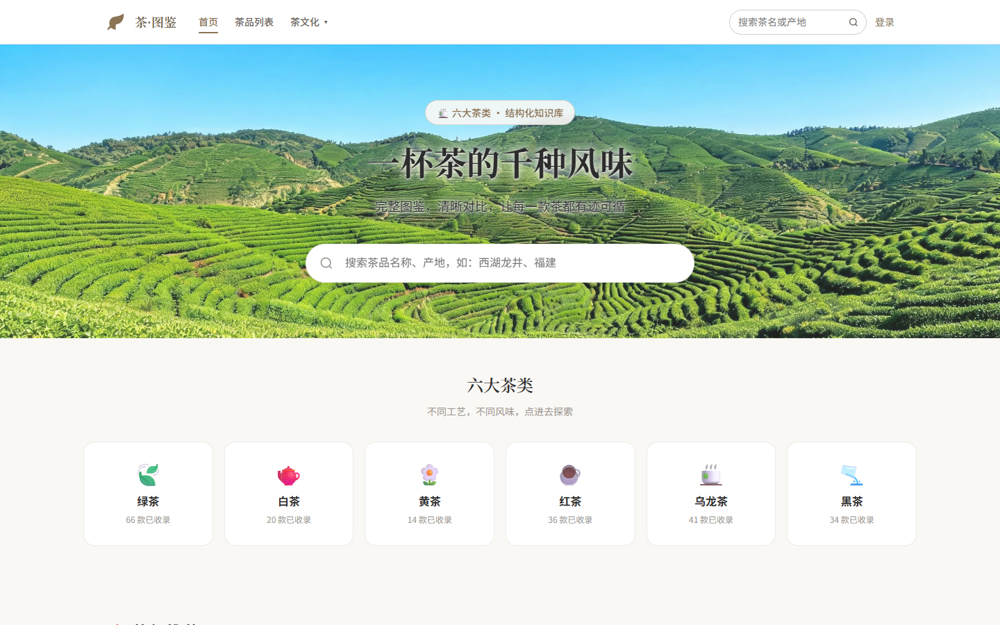
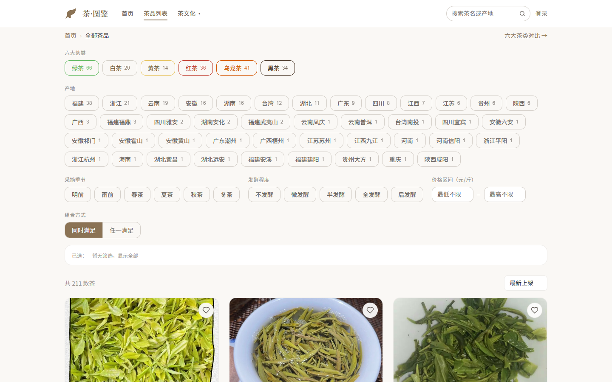
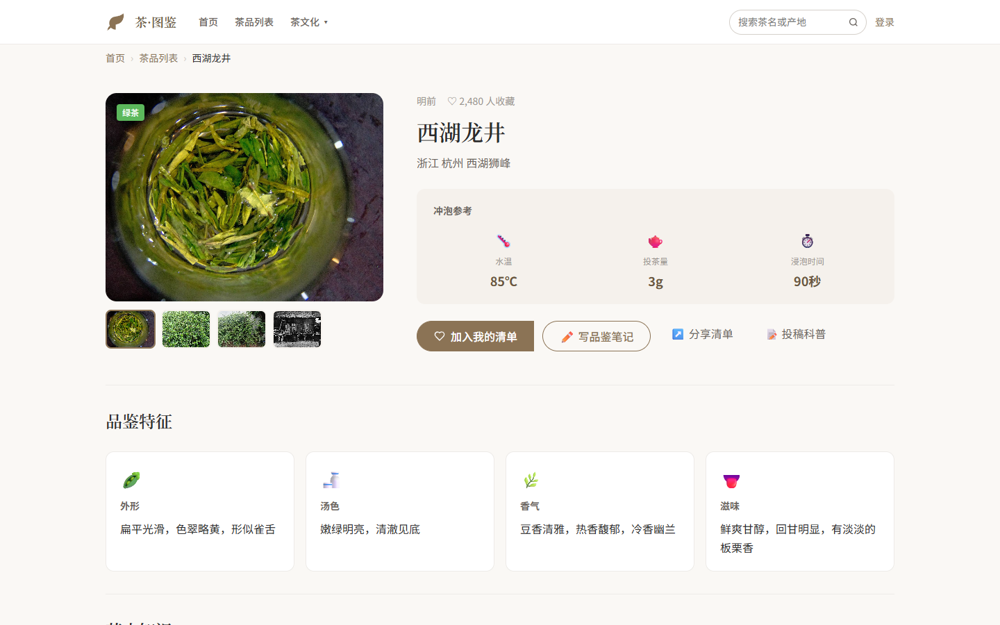
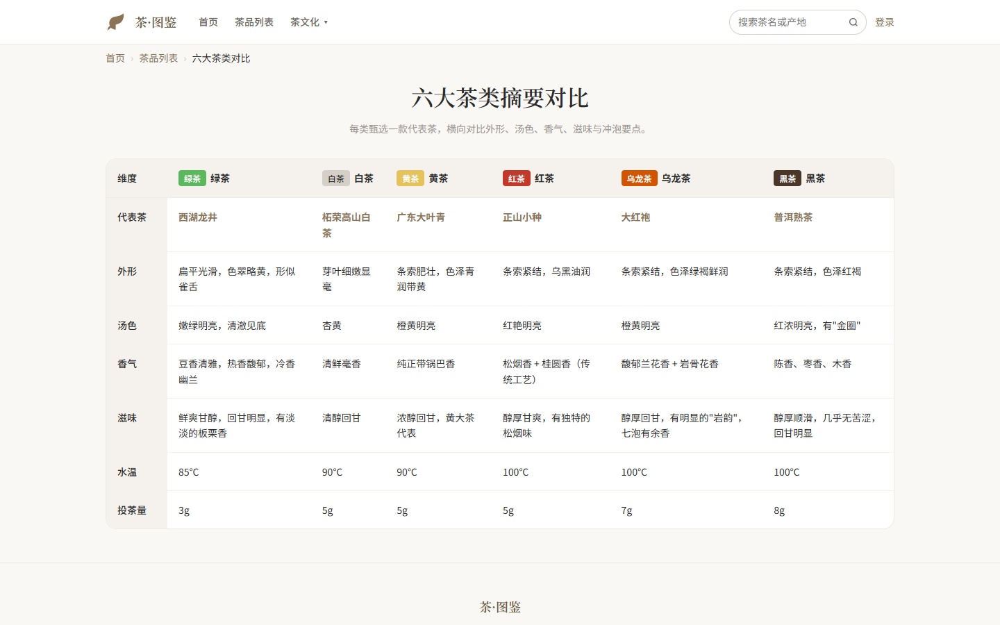
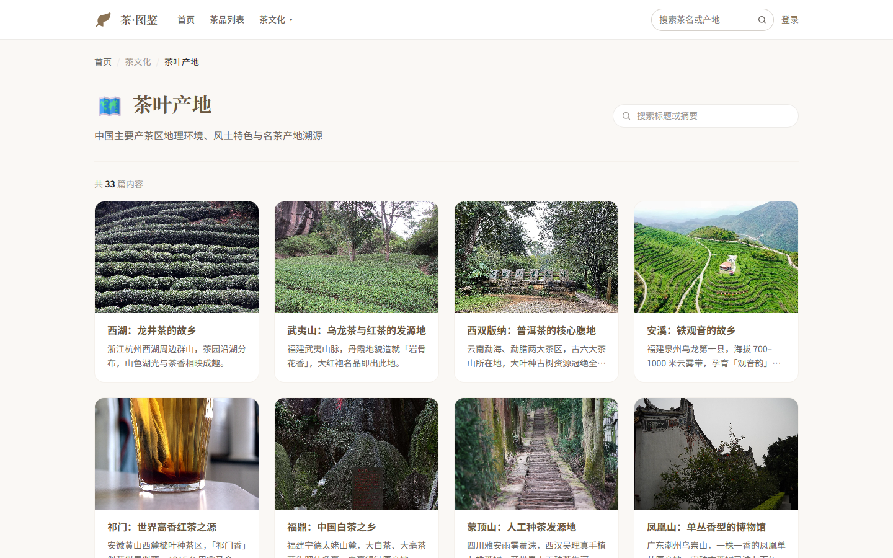
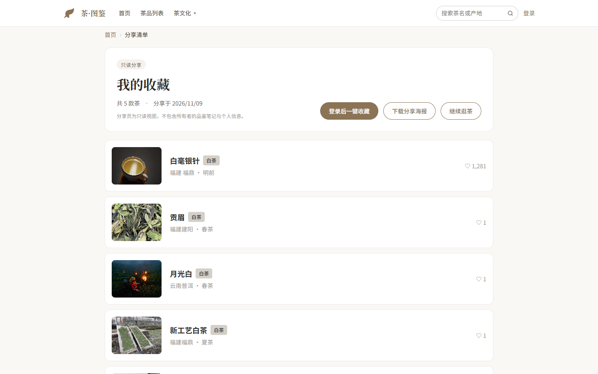
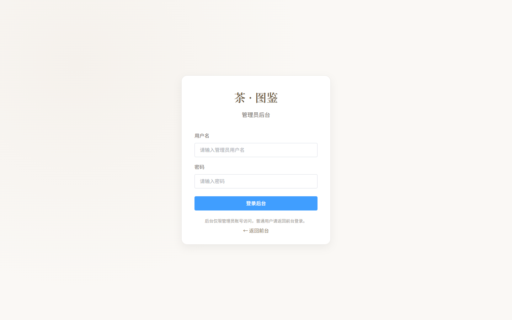
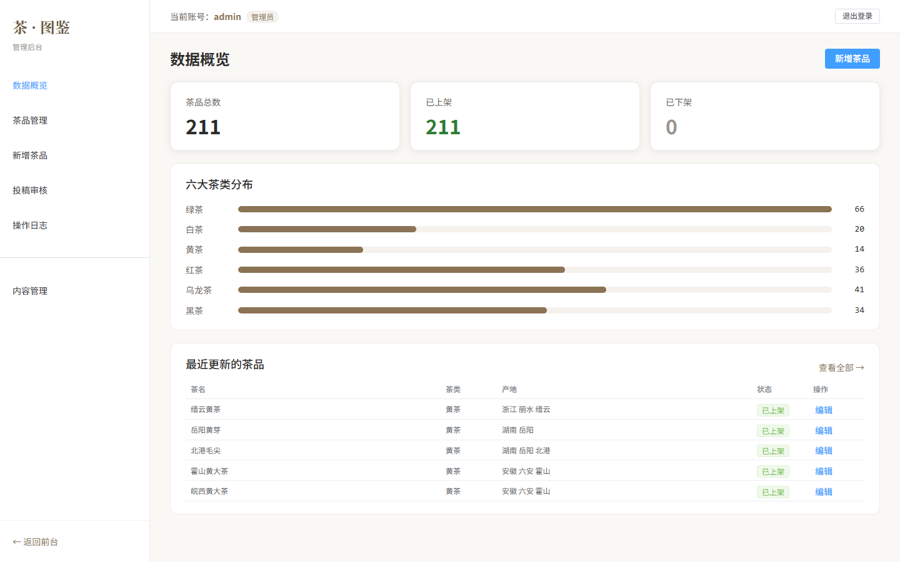
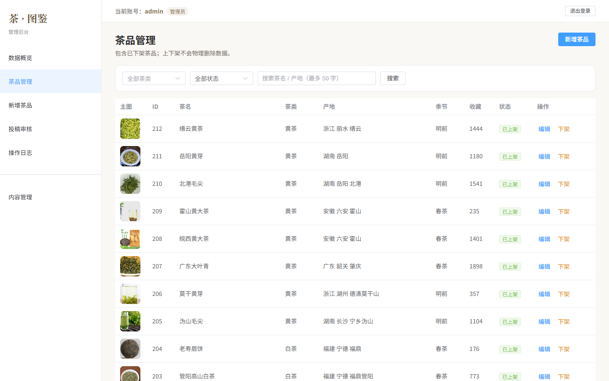

# 茶·图鉴

> 七大茶类结构化知识库平台 —— MVP + 第二阶段扩展
> 核心闭环：**发现茶 → 查看详情 → 收藏 / 写笔记 / 分享 / 投稿**

---

## 1. 项目简介

「茶·图鉴」是一个面向茶爱好者的七大茶类（绿茶 / 白茶 / 黄茶 / 红茶 / 乌龙茶 / 黑茶 / 再加工茶）结构化知识库平台。系统将每款茶品整理为标准化图鉴卡片（外形、汤色、香气、滋味、冲泡参数、官方小贴士），支持多维筛选与关键词搜索。注册用户可以收藏茶品、撰写私有品鉴笔记、生成公开分享链接，也可以投稿新茶与茶文化内容；管理员通过独立后台维护茶品、小贴士、冲泡指南、投稿审核与内容运营。

项目采用前后端分离架构，全部接口遵循统一响应体契约，开发过程遵循规范驱动开发（SDD）流程，权威文档见 `docs/` 目录。

## 2. 项目建设目标

- 构建七大茶类的结构化知识库，茶品信息字段标准化、可筛选、可检索。
- 打通「发现茶 → 查看详情 → 收藏 / 写笔记 / 分享」的 MVP 核心闭环。
- 三种角色支撑：游客（只读浏览）、注册用户（收藏、笔记、分享）、管理员（茶品与小贴士维护）。
- 建立规范驱动的工程体系：五层后端架构、统一 API 契约、安全控制项（S-01~S-35）、100 条测试用例与静态检查脚本。

**范围现状**：第一阶段 MVP 与第二阶段扩展（PRD S1–S17）已全部实现并冻结；暂不实现项（X1–X13）维持不开发。新增功能需求按 C 类先确认后实施。

## 3. 系统功能介绍

### 3.1 游客

- 首页：Hero 搜索（150ms 防抖建议）、七大茶类计数入口、热门茶品轨道、随机发现（换一批）。
- 茶品列表：茶类 / 产地 / 季节三维筛选（同维 OR、跨维 AND）、关键词搜索（名称与产地）、四种排序、分页（每页 12 条）、空结果与加载态。
- 茶品详情：主图、冲泡参考（水温 / 投茶量 / 浸泡时间）、四大感官描述、官方小贴士（空值区块隐藏）、同类推荐。
- 分享公开页：免登录只读查看他人分享的清单；下架茶品灰显；已撤销分享显示撤销态。

### 3.2 注册用户

- 注册 / 登录 / 退出（HttpOnly Cookie 会话，有效期 30 天）；注册时用户名可用性防抖校验。
- 收藏 / 取消收藏茶品（幂等，收藏计数原子增减；已下架茶品不可新增收藏）。
- 我的清单：首次访问自动创建默认清单「我的收藏」；支持修改清单标题（2–20 字）、移除条目、下架条目灰显。
- 品鉴笔记：对已收藏茶品撰写私有笔记（≤20,000 字，纯空白归一化为清空），仅本人可见。
- 分享：生成 8 位 URL-safe 分享链接（已有有效链接则复用）、复制链接、二次确认撤销（撤销后旧链接永久失效）；对他人分享的清单可「一键收藏全部」（跳过已收藏 / 已下架，返回 added / skipped / total 统计）。
- 登录前点击收藏 / 笔记 / 分享会暂存动作，登录回跳后自动继续。
- 投稿：提交新茶或茶文化内容，查看本人投稿记录与审核状态；待审核投稿可撤回。
- 茶文化内容：浏览内容列表与详情。

### 3.3 管理员（`/admin` 后台，前端按需加载）

- 管理员登录（非 admin 角色登录后立即注销会话）。
- 数据概览：统计卡片、七大茶类分布、最近新增茶品。
- 茶品管理：新增 / 编辑（PUT 全量替换）/ 上架 / 下架（二次确认，软失效不物理删除）、茶类 / 状态 / 关键词筛选、分页、含下架列表。
- 官方小贴士维护（省略保持不变、置 null 清空）。
- 图片上传：仅 JPEG / PNG / WebP，≤5MB，服务端魔数校验，UUID 文件名，落盘 `uploads/YYYY/MM/`。
- 所有写操作同步写入 `operation_logs` 操作日志（同事务）；后台「操作日志」页只读查询（动作 / 目标类型 / 操作人 / 日期筛选 + 分页）。
- 投稿审核：查看待审队列，通过 / 拒绝（拒绝理由必填），审核动作留痕。
- 内容运营：茶文化内容的新增 / 编辑 / 上下架。
- 冲泡指南维护与茶品视频上传（视频 ≤50MB，Nginx 对视频端点单独放宽至 52MB）。

### 3.4 第二阶段扩展（已完成）

- 用户投稿与管理员审核（S10–S13）：新茶 / 茶文化内容投稿、待审队列、通过 / 拒绝与理由回传、本人记录查询与撤回。
- 茶文化内容平台：内容分类、列表、详情与后台运营。
- 冲泡指南：茶品详情展示水温 / 投茶量 / 浸泡时间等结构化参数。
- 茶品视频：管理员为茶品上传 ≤50MB 视频，前台详情播放。
- 个性化推荐：登录用户按收藏偏好推荐，支持 `exclude_id` 实现「换一款」不重复。

### 3.5 接口概览

统一前缀 `/api/v1`，统一响应体 `{ code, message, data }`。共 **60 个业务端点**（auth 6 / me 3 / teas 9 / tips 1 / favorites 3 / lists 6 / shares 4 / admin 17 / contributions 3 / contents 3 / admin-contents 5）+ 1 个健康检查端点 `/api/v1/health`。完整契约见 [docs/api/API_CONTRACT.md](docs/api/API_CONTRACT.md) 与 [docs/api/openapi.yaml](docs/api/openapi.yaml)。

## 4. 系统技术栈

| 层 | 技术 |
|---|---|
| 前端 | Vue 3（`<script setup>`）+ TypeScript + Vite + Vue Router 4 + Pinia + Axios |
| UI | 前台自研组件（`:root` CSS 变量 + BEM，视觉还原自 `原型/`）；Element Plus **仅用于管理员后台**且按需动态加载 |
| 后端 | Python 3.11+ / FastAPI / SQLAlchemy 2.0（同步模式）/ Alembic / PyMySQL |
| 安全 | bcrypt（cost=10）密码哈希 / itsdangerous 签名 Cookie 会话 |
| 数据库 | MySQL 5.7.19 · InnoDB · utf8mb4 / utf8mb4_unicode_ci，共 14 张表 |
| 测试 | 后端 pytest + httpx（TestClient，真实 MySQL 测试库）；前端 Vitest（纯函数） |
| 包管理 | npm（`frontend/package-lock.json` 为唯一 lockfile）；Python venv + pip |
| 部署形态 | 开发期 Vite proxy 同源；生产 Nginx 反代 + Uvicorn（见 §13） |

技术选型定稿见 [docs/architecture/TECH_STACK.md](docs/architecture/TECH_STACK.md)。

## 5. 项目目录结构

```text
项目二/
├── backend/                    # FastAPI 后端
│   ├── app/
│   │   ├── main.py             # 应用入口（中间件 / 异常处理 / 路由注册 / 静态挂载）
│   │   ├── core/               # config / database / security / response / auth_deps
│   │   ├── routers/            # 路由层：auth / teas / favorites / lists / shares / contributions / contents / admin
│   │   ├── services/           # 业务规则与事务边界
│   │   ├── repositories/       # SQLAlchemy 查询封装
│   │   ├── models/             # ORM 实体（14 张表一一对应）
│   │   ├── schemas/            # Pydantic DTO
│   │   ├── scripts/            # 管理员工具（rotate_admin_password / recount_favorite_counts）
│   │   └── alembic/            # 迁移环境（0001–0013 迁移链，见 §12）
│   ├── tests/                  # pytest 用例（197 条）
│   ├── uploads/                # 图片本地存储（不进 Git）
│   ├── run.py                  # 开发启动脚本
│   ├── requirements.txt
│   └── .env.example            # 环境变量示例
├── frontend/                   # Vue 3 SPA
│   └── src/
│       ├── api/                # Axios 实例与请求封装（baseURL=/api/v1，withCredentials）
│       ├── assets/  components/  router/  stores/  styles/  types/  utils/
│       ├── views/              # 前台页面（首页/列表/详情/我的清单/分享/登录/注册/404）
│       └── views/admin/        # 管理员后台 9 个页面组件（动态 import 按需加载）
├── database/
│   └── init.sql                # 建库 + 建表 + 索引 + 种子数据
├── docs/                       # 权威文档（PRD / 架构 / API 契约 / 安全 / 设计 / 测试）
├── scripts/                    # 静态检查脚本（check_all.py 等 7 个）
├── harness/                    # 任务卡模板与 build-log.md 开发日志
├── .github/                    # CI 工作流与 PR 模板
├── 原型/                        # 静态原型（前台视觉还原基准，勿改）
└── AGENTS.md                   # 项目工作指南（入口文档）
```

## 6. 数据库初始化方法

前置条件：已安装并启动 MySQL 5.7.19+。

```bash
mysql -u root -p < database/init.sql
```

脚本将创建数据库 `tea_guide`（utf8mb4 / utf8mb4_unicode_ci）、14 张表（`users` / `teas` / `tea_tips` / `tea_brewing_guides` / `collection_lists` / `favorite_items` / `share_tokens` / `operation_logs` / `tea_media` / `login_attempts` / `contributions` / `tea_name_category_map` / `content_types` / `content_items`）及种子数据（管理员账号 1 个、六大基础茶类示例茶品各 1 款、对应小贴士）。

注意事项：

- 脚本**不包含 DROP TABLE**，重复执行会在建表阶段报错；如需重建请先手动删除数据库。
- 种子管理员为开发用途，初始口令见 `database/init.sql` 注释，**上线前必须使用轮换脚本修改**（见 §9）。
- 运行测试前需额外创建测试库：测试默认连接 `tea_guide_test`（结构与 `tea_guide` 相同，可再次执行 init.sql 后改名导入，或设置 `DATABASE_URL_TEST` 指向自定义测试库）。

## 7. 后端启动方法

前置条件：Python 3.11+（开发验证使用 3.12）、已完成 §6 数据库初始化。

```bash
cd backend
python -m venv .venv
# Windows PowerShell:
.venv\Scripts\Activate.ps1
pip install -r requirements.txt

# 首次运行：复制并按本机环境修改配置（SECRET_KEY 必填，缺失将拒绝启动）
copy .env.example .env
python -c "import secrets; print(secrets.token_urlsafe(48))"   # 生成 SECRET_KEY 填入 .env

python run.py
```

- 开发模式监听 `http://127.0.0.1:8000`，开启热重载。
- 接口文档（Swagger UI）：`http://127.0.0.1:8000/docs`
- 健康检查：`GET http://127.0.0.1:8000/api/v1/health`，正常返回 `{"code":0,"message":"ok","data":{"status":"ok"}}`。

## 8. 前端启动方法

前置条件：Node.js 20+（开发验证使用 v24，CI 使用 20）与 npm。

```bash
cd frontend
npm install
npm run dev
```

- 开发服务器：`http://localhost:5173`
- Vite 已将 `/api` 与 `/uploads` 代理到 `http://127.0.0.1:8000`，开发期前后端同源，无需处理跨域。
- 管理员后台入口：`http://localhost:5173/admin/login`
- 生产构建：`npm run build`（产物在 `frontend/dist/`）。

## 9. 配置文件说明

| 文件 | 用途 | 关键项 |
|---|---|---|
| `backend/.env` | 后端环境变量（**不进 Git**，由 `.env.example` 复制生成） | 见下表 |
| `backend/.env.example` | 环境变量示例（可提交） | 全部项含注释 |
| `backend/alembic.ini` | Alembic 迁移配置 | 连接串为占位值，实际由 `app/alembic/env.py` 从配置注入 |
| `backend/pyproject.toml` | Ruff lint / format 配置 | —— |
| `frontend/vite.config.ts` | 开发服务器与代理 | 端口 5173；`/api`、`/uploads` 代理至 8000 |
| `frontend/vitest.config.ts` | 前端单元测试配置 | —— |
| `frontend/eslint.config.js` / `.prettierrc.json` | 前端代码规范 | —— |
| `.github/workflows/ci.yml` | CI：后端 lint+test、前端 lint+test、文档守卫 | —— |

`backend/.env` 关键环境变量：

| 变量 | 说明 | 默认值 / 要求 |
|---|---|---|
| `DEBUG` | 调试模式（开启会将 SQL 写入日志） | 默认 `false`，生产必须保持 `false` |
| `MYSQL_HOST` / `MYSQL_PORT` / `MYSQL_USER` / `MYSQL_PASSWORD` / `MYSQL_DATABASE` | MySQL 连接 | 密码无默认值，必须注入 |
| `SECRET_KEY` | 会话签名密钥 | **必填，缺失拒绝启动**；用 `secrets.token_urlsafe(48)` 生成 |
| `SESSION_EXPIRE_DAYS` | 会话有效期（天） | 30 |
| `COOKIE_SECURE` | 会话 Cookie 是否带 `Secure` | 未设置时默认 `not DEBUG`；纯 HTTP 的演示/内网部署必须显式设为 `false`，否则浏览器不会保存 Cookie，表现为登录成功但后续请求 401 |
| `ADMIN_USERNAME` / `ADMIN_PASSWORD` | 管理员初始账号 | 密码无默认值，生产必须注入 |
| `DATABASE_URL_TEST` | （可选）测试库连接串 | 默认使用 `tea_guide_test` |

管理员密码轮换（不重启服务即可生效）：

```bash
cd backend
python -m app.scripts.rotate_admin_password --password "新密码"
```

> 请勿将真实数据库密码、SECRET_KEY 等敏感信息提交到仓库；`.env` 已被 `.gitignore` 覆盖，`.dockerignore` 也已排除。**压缩整个项目文件夹分享或提交评审前，请先确认 `backend/.env` 未被一并打包**；该文件包含数据库口令、管理员口令与会话密钥。

## 10. 测试方法和测试结果

### 10.1 测试方法

| 范围 | 命令 |
|---|---|
| 后端全量测试 | `cd backend; python -m pytest -q` |
| 后端 lint / 格式 | `cd backend; python -m ruff check app tests; python -m ruff format --check app tests` |
| 前端单元测试 | `cd frontend; npm run test:run` |
| 前端 lint / 类型 / 格式 / 构建 | `cd frontend; npm run lint; npm run typecheck; npm run format:check; npm run build` |
| 全量静态检查（链接 / 常量 / 分层 / UI / 记录 / 密钥） | `python scripts/check_all.py` |

测试用例依据 [docs/testing/TEST_PLAN.md](docs/testing/TEST_PLAN.md)（TEST_PLAN v1.7 共 100 条用例（高 56 / 中 41 / 低 3），覆盖 60 个业务端点、14 张表约束与 35 项安全控制；G5 阶段 60 条用例的逐条历史记录见 [docs/testing/TEST_REPORT.md](docs/testing/TEST_REPORT.md)）。

### 10.2 测试结果（2026-11-12 实际执行）

| 项 | 结果 |
|---|---|
| 后端 pytest 全量 | **197 passed**（0 失败、0 跳过；含 20 线程并发收藏 / 分享真实并发用例；`datetime.utcnow` / Pydantic `class Config` 弃用告警已清理） |
| TEST_PLAN G5 阶段 60 条用例 | **60 / 60 通过，高优先级 32 / 32 通过**（2026-11-08 历史记录；TEST_PLAN 已扩展至 100 条） |
| 前端 Vitest | **89 passed**（13 个 spec 文件，纯函数用例） |
| 前端 ESLint / vue-tsc / Prettier / 生产构建 | 全部通过（1825 modules；主入口 104.09 kB / gzip 37.18 kB；后台 Element Plus 异步 chunk 998.39 kB，触发 >500 kB 提示，非失败） |
| `scripts/check_all.py` 静态检查 | 全部通过（300 条文档链接、60/100/35/14 常量一致、五层分层 0 违规、268 个文本文件无敏感信息泄露；`backend/.env` 触发“分享前排除”WARN） |
| Gitee Go CI（`.workflow/ci.yml`） | **未运行**（流水线文件已提交，尚未在 Gitee 远端实际触发，不标记为通过） |
| GitHub Actions CI | **未运行**（保留为备份工作流，尚未在远端实际执行） |

## 11. 系统截图

以下截图于 2026-11-11 在本地开发环境（视口 1440×900）实机截取，文件存放于 `docs/images/`。

### 11.1 前台

**首页（Hero 搜索 + 七大茶类入口 + 热门茶品）**



**茶品列表（三维筛选 + 分页）**



**茶品详情（主图 + 冲泡参考 + 品鉴特征）**



**七大茶类对比**



**茶文化内容列表**



**分享公开页（免登录只读）**



### 11.2 管理员后台

**管理员登录**



**数据概览**



**茶品管理**



## 12. 当前已知问题和后续改进方向

### 已知问题 / 限制

1. ~~系统截图缺失~~（已完成 2026-11-11）：README §11 已收录前台 6 张 + 后台 3 张实机截图（`docs/images/`）。
2. **CI 远程触发**：已新增 Gitee Go 流水线 [.workflow/ci.yml](.workflow/ci.yml)（后端静态检查 + 前端全检查），保留 [.github/workflows/ci.yml](.github/workflows/ci.yml) 作为备份；**尚未在 Gitee 远端实际触发验证**。Gitee Go 云端环境无 MySQL，pytest 仍以本地 / GitHub Actions service container 为准。
3. **Alembic 全新环境接管方式**：baseline 迁移（0001）已生成且版本链推进至 0013；`init.sql` 已随批次演进包含最新全部结构与种子，全新环境流程为 `init.sql 建库 → alembic stamp head`（2026-11-10 部署演练修正：旧流程 stamp 0001 后 upgrade 会与 init.sql 已有列冲突）。既有旧环境直接 `alembic upgrade head`。
4. **构建体积告警**：路由已改为按页面懒加载，主入口 chunk 约 104 kB（gzip 37 kB），Vue/Pinia/Router 与 qrcode 独立分包；Element Plus 仅在后台加载，其 vendor chunk 约 998 kB（gzip 321 kB），构建仍提示 >500 kB，属后台异步包，不影响前台首屏。
5. **随机关联推荐成本**：热门 / 随机推荐使用 `ORDER BY RAND()`，当前数据量级（<1000）下可接受，数据量增长后需改为随机偏移方案。
6. ~~登出后旧 Cookie 重放~~（已修复 2026-11-11）：登出时递增 `users.session_version`，旧 Cookie 立即 `40100`；因无 `sessions` 表，吊销为**用户级**（该账号所有设备会话同时失效）。
7. **种子数据量**：`init.sql` 示例茶品为每类 1 款；开发环境已通过脚本扩充至 211 款（见 build-log 2026-11-11），生产数据需按运营计划导入。
8. **生产网关 413 复测**：`deploy/nginx.conf` 全局 `client_max_body_size 6m`，并对 `POST /api/v1/admin/media/video` 单独放宽到 `52m`；尚未在真实 Nginx 环境做 6–50MB 视频上传复测。

### 后续改进方向（均未实现，属规划项）

- ~~生成 Alembic baseline 迁移~~（已完成：0001_baseline 起 13 个迁移；全新环境改为 `stamp head` 接管，见已知问题 3）。
- ~~补充 Docker Compose（`web` + `api` + `mysql`）一键部署~~（已完成配置，待真实服务器验证，见 §13）。
- 在 Gitee Go 与 GitHub Actions 远端实跑 CI 并回填结果。
- ~~PRD 第二阶段需求（S1–S17）~~（已完成并冻结，见 §3.4）；暂不实现项（X1–X13）维持不开发。

## 13. 部署（Docker Compose 推荐）

### 13.1 部署条件检查结论

| 检查项 | 状态 | 说明 |
|---|---|---|
| 前端生产构建 | ✅ | `npm run build` 通过，产出 `frontend/dist/` |
| 后端依赖清单 | ✅ | `requirements.txt` 完整，含 `uvicorn[standard]` 可用于生产 |
| 配置模板 | ✅ | `deploy/env.example` 完整；缺失 `SECRET_KEY` 时后端拒绝启动 |
| 数据库初始化脚本 | ✅ | `database/init.sql` 可建库建表 + 种子数据（MySQL 5.7 容器自动执行） |
| 数据库迁移 | ⚠️ | 已生成 0001–0013 迁移；全新环境 `init.sql` + `alembic stamp head`，既有环境 `alembic upgrade head` |
| Web 服务器 / 容器配置 | ✅（待实机验证） | 仓库提供 `docker-compose.yml`、`deploy/Dockerfile.backend`、`deploy/Dockerfile.frontend`、`deploy/nginx.conf` |
| 实机部署验证 | ❌ | **尚未在服务器环境实际执行**；本次仅完成 YAML 语法校验（本机未安装 Docker） |
| 管理员口令 | ⚠️ | 种子管理员口令为开发用途，部署后必须立即轮换 |

**结论：一键部署文件已就绪，首次部署仍建议按下列步骤逐项核对，并完成一次真实服务器的健康检查与主链路冒烟。**

### 13.2 Docker Compose 部署步骤

目标形态：浏览器 → `web`（Nginx，8080）→ 静态 `dist/` + 反代 `/api`、`/uploads` → `api`（Uvicorn:8000）→ `mysql`（5.7）。

1. **准备环境变量**：`cp deploy/env.example .env`，填写 `MYSQL_ROOT_PASSWORD`、`MYSQL_APP_PASSWORD`、`SECRET_KEY`、`ADMIN_PASSWORD`。
2. **启动**：`docker compose up -d --build`。
3. **等待就绪**：`mysql` 健康检查通过后 `api` 启动，`api` 健康检查通过后 `web` 启动；MySQL 首次初始化会自动执行 `database/init.sql`。
4. **访问验证**：浏览器打开 `http://<服务器IP>:8080`；`GET /api/v1/health` 应返回 `{"code":0,...}`。当前 Compose 默认只提供 HTTP，`.env` 必须显式设置 `COOKIE_SECURE=false`，否则浏览器会拒绝保存带 `Secure` 的会话 Cookie（登录接口返回 200，但后续请求全部 401）。若已在前面挂了 HTTPS，则设为 `true`。
5. **管理员口令轮换**：`docker compose exec api python -m app.scripts.rotate_admin_password --password "新密码"`。
6. **数据持久化**：MySQL 数据在 `mysql_data` 卷；图片通过 `./backend/uploads` 绑定挂载，重启/重建容器不丢失。
7. **更新发布**：`git pull && docker compose up -d --build`。
8. **HTTPS**：生产环境必须在 `web` 前再挂一层反向代理或扩展 `deploy/nginx.conf` 配置证书，并将 `COOKIE_SECURE` 设为 `true`；仅内网 HTTP 演示可保持 `false`。

### 13.3 手工部署（备选）

1. 服务器安装 Python 3.11+、Node.js 20+、MySQL 5.7.19+、Nginx。
2. `mysql -u root -p < database/init.sql`。
3. 后端：`cd backend; python -m venv .venv; pip install -r requirements.txt`；编写 `.env` 注入随机 `SECRET_KEY`、真实 `MYSQL_PASSWORD`、`ADMIN_PASSWORD`，确认 `DEBUG=false`；`uvicorn app.main:app --host 127.0.0.1 --port 8000`。
4. 前端：`cd frontend; npm ci; npm run build`，将 `dist/` 交给 Nginx。
5. Nginx：静态根指向 `dist/`；`/api/`、`/uploads/` 反代 `http://127.0.0.1:8000`；全局 `client_max_body_size 6m;`，并为 `location = /api/v1/admin/media/video` 单独设置 `client_max_body_size 52m;`（否则 6–50MB 视频会被网关 413）；SPA 回退 `try_files $uri /index.html;`（可参考 `deploy/nginx.conf`）。
6. 上线验证：`/api/v1/health`、注册 / 登录 / 收藏 / 分享主链路、超大请求体 413。

---

## 文档索引

| 文档 | 说明 |
|---|---|
| [AGENTS.md](AGENTS.md) | 项目工作指南（速览 / 红线 / 任务路由） |
| [docs/product/PRD.md](docs/product/PRD.md) | 产品需求（功能分级唯一依据） |
| [docs/architecture/](docs/architecture/) | 技术栈 / 架构 / 数据模型 / 安全控制 |
| [docs/api/API_CONTRACT.md](docs/api/API_CONTRACT.md) | API 契约（前后端联调唯一依据） |
| [docs/design/](docs/design/) | 设计系统与页面规范 |
| [docs/testing/TEST_PLAN.md](docs/testing/TEST_PLAN.md) / [TEST_REPORT.md](docs/testing/TEST_REPORT.md) | 测试用例与实测报告 |
| [harness/build-log.md](harness/build-log.md) | 开发变更与测试证据流水 |
