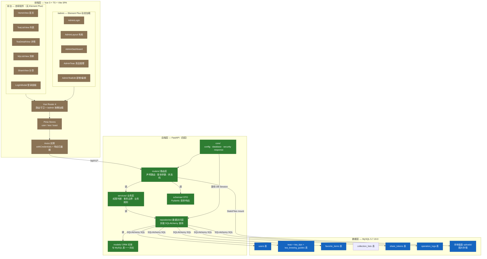

# 茶·图鉴 —— 系统架构设计

| 项 | 值 |
|---|---|
| 文档版本 | v1.0（架构定稿） |
| 创建日期 | 2026-11-05 |
| 分析依据 | [PRD.md](../product/PRD.md) v1.1 · [TECH_STACK.md](./TECH_STACK.md) v1.0（决策 1-9 全部已确认）· [DESIGN_SYSTEM.md](../design/DESIGN_SYSTEM.md) |
| 范围边界 | **仅覆盖 MVP（PRD §2.1）**；S1–S17 第二阶段功能一律不进架构图与模块划分，仅在文末「扩展预留」说明接口位置 |

---

## 1. 架构形态与三方职责

### 1.1 架构形态

前后端分离，三层纵向：

| 层 | 形态 | 端口 | 技术 |
|---|---|---|---|
| 前端 | **单 SPA**（Vue 3 + TS + Vite）；含 `/admin` 路由段，后台组件通过动态 `import()` 按需加载 | 开发期 5173 / 生产 Nginx 80/443 | Vue Router 4、Pinia、Axios、Element Plus（仅后台） |
| 后端 | **FastAPI 独立进程**；只提供 REST + JSON，不渲染页面；前端和数据库都只能通过它访问 | 开发期 8000 / 生产 Nginx 反代 | FastAPI + SQLAlchemy 2.0（同步）+ Alembic |
| 数据库 | **MySQL 5.7.19.0 社区版**，字符集 `utf8mb4`、排序规则 `utf8mb4_unicode_ci`；由后端独占访问，前端不得直连 | 3306 | PyMySQL 驱动 |

### 1.2 三方职责边界

```
┌─────────── 前端 ───────────┐  ┌─────────── 后端 ───────────┐  ┌─────── 数据库 ───────┐
│ · 页面渲染与交互            │  │ · 业务逻辑执行               │  │ · 数据持久化          │
│ · 路由（前台 + /admin）     │  │ · 身份校验与权限控制          │  │ · 数据完整性约束      │
│ · Pinia 全局状态            │  │ · 参数校验（Pydantic）       │  │ · 索引与查询加速      │
│ · Axios 请求与错误处理      │  │ · 统一响应体封装              │  │ · 事务（ACID）        │
│ · 本地登录态缓存（localStg）│  │ · Session/Cookie 管理        │  │                       │
│ · UI 组件 & 视觉呈现        │  │ · 图片上传 + StaticFiles     │  │                       │
│                             │  │ · ORM 数据访问                │  │                       │
└─────────────────────────────┘  └────────────────────────────┘  └───────────────────────┘
       只能调 HTTP API                   只能执行 SQL ORM                   只能存数据
```

### 1.3 已定决策的落点

| 决策 | 落点 | 对应 TECH_STACK 编号 |
|---|---|---|
| 认证：HttpOnly Cookie + 服务端 session，30 天 | 后端 `app/core/security.py`（bcrypt 哈希 + itsdangerous 签名 Cookie）+ `app/routers/auth.py`（register/login/logout 设/清 Cookie）。**最终不建 `sessions` 表**（签名的无状态 Cookie 已满足 FR-4.3），见 DATA_MODEL §1 | 6 |
| 跨域：开发期 Vite proxy `/api` → 8000，全程同源 | `frontend/vite.config.ts` 已配置 | 2 |
| 统一响应体：`{ code, message, data }` | 后端 `app/core/response.py` + Axios 响应拦截器 `frontend/src/api/request.ts` | 3 |
| 图片：本地磁盘 + FastAPI StaticFiles 挂载 uploads/ | `backend/app/main.py` 的 `app.mount("/uploads", ...)` | D 取舍 |
| 类型链路：Pydantic ↔ TS interface | 后端 `app/schemas/` 与前端 `src/types/` 一一对应；后续通过 openapi-typescript 自动生成 | 6 |
| Element Plus 仅管理员后台 | 前端 `main.ts` 全局注册；前台自研组件迁移原型 CSS | 2 |
| CSS：`:root` 自定义属性 + BEM | `frontend/src/style.css` 已落地 | 4 |
| MySQL 5.7.19.0 / utf8mb4_unicode_ci | 已在 `database/init.sql` 中建库；表设计见 `DATA_MODEL.md` | 9 |
| 后端五层架构 | 本架构文档 §3 定义 | 6 |

---

## 2. 系统总体架构图（graph TB）



---

## 3. 后端五层架构

> **注意**：TECH_STACK.md §5 建议的仓库结构中未显式列出 `repositories/` 层，但用户明确要求五层架构。脚手架已生成的后端目录只有四层（缺 `repositories/`），**后续开发第一步需在 `backend/app/` 下创建 `repositories/` 目录**，并把 `services/` 中直接写 SQLAlchemy 查询的代码下沉到 repository 层。

### 3.1 五层定义

| 层 | 目录 | 职责 | 允许的调用方向 | 禁止项 |
|---|---|---|---|---|
| **routers/** | Controller | 路由声明、参数接收（`Depends`）、依赖注入（`get_db` / `get_current_user`）、状态码返回 | → Service, → Schema | **禁止写业务逻辑**（权限判断、字段默认值、事务分支）；**禁止直接 import models 查库**；**禁止返回 ORM 对象给前端** |
| **services/** | 业务逻辑 | 事务边界（一个 Service 方法 = 一个业务操作的原子单元）、权限判断（角色矩阵落点）、业务规则（AND 筛选、收藏唯一性、分享令牌有效期）、跨仓库组合 | → Router, → Repository | **禁止直接拼 SQL**（一律走 Repository）；**禁止返回 ORM 对象**（返回 Pydantic Schema 或 plain dict） |
| **repositories/** | 数据访问 | 封装 SQLAlchemy 查询（增删改查、聚合、JOIN、排序、分页），一个 Repository 对应一张或紧密关联的几张表 | → Service, → Model | **禁止含业务判断**（权限校验、业务枚举、事务回滚逻辑）；**禁止返回 Response 或抛业务异常**（抛出 `HTTPException` 或 `TeaGuideError` 由 Service 层处理） |
| **models/** | 实体 | SQLAlchemy ORM 模型定义，与 MySQL 表一一对应，包含列定义、关系映射、索引声明 | ← 只有 Repository 能碰 | **禁止承载业务方法**（`to_response()` / `validate()` 等一律不放这里）；**禁止 import Service/Router** |
| **schemas/** | DTO | Pydantic 请求/响应模型定义，与前端 `src/types/` 一一对应 | ← 只有 Router 和 Service 能碰 | **禁止承载业务方法**；**禁止 import Model**（Pydantic 不依赖 ORM；ORM 转 Pydantic 显式在 Service/Router 里做） |

### 3.2 五层调用链示意

```
HTTP Request
    │
    ▼
┌─────────────────────────────────┐
│ routers/tea_router.get_tea()     │ ← 路由声明 + 参数接收
│ · FastAPI path/query/model      │
│ · Depends(get_db) 获取 session  │
│ · Depends(get_current_user)    │  ← 鉴权依赖注入
└──────────┬──────────────────────┘
           │ 调
           ▼
┌─────────────────────────────────┐
│ services/tea_service.get_tea()  │ ← 业务规则
│ · 检查 is_active 状态           │
│ · 权限判断（管理员可看下架）     │
│ · 业务异常抛出（TeaNotFound）   │
└──────────┬──────────────────────┘
           │ 调
           ▼
┌─────────────────────────────────┐
│ repositories/tea_repo.get_by_id │ ← 纯查询
│ · db.query(Tea).filter(...).one │
│ · db.query(Tea).join(TeaTips)   │
│ · db.query(func.count(...))     │
└──────────┬──────────────────────┘
           │ 返回 ORM 对象
           ▼
┌─────────────────────────────────┐
│ models/Tea + TeaTips            │ ← 数据承载
│ · 列定义 + 关系映射              │
└─────────────────────────────────┘
           │
           │ ORM → Schema 显式转换（Service 层做 model_dump）
           │
           ▼
┌─────────────────────────────────┐
│ schemas/tea.TeaResponse         │ ← 响应 DTO
│ · Pydantic model                │
│ · ConfigDict(from_attributes)   │
└──────────┬──────────────────────┘
           │
           ▼
统一响应体 ok(data) → Router 包装 → HTTP 200
```

### 3.3 跨层禁止清单（红线）

| 禁止 | 后果 | 检测方式 |
|---|---|---|
| Router 直接 `db.query(...)` 查库 | 路由膨胀、业务规则散落在路由各处、无法单测 Service | Code Review 检查 router 文件里是否出现 `db.query` / `session.query` |
| Service 返回 ORM 对象 | ORM 对象含延迟加载属性，前端拿到会序列化报错或泄露数据库内部状态 | Service 方法返回类型声明 `-> TeaResponse`（Pydantic）而非 `-> Tea`（ORM） |
| Schema import Model | Pydantic 模型与 ORM 耦合，迁移 ORM 时 DTO 要重写 | lint：schema 文件里不允许出现 `from app.models` |
| Repository 抛业务异常 | 数据访问层变"业务层 + 数据层"混合，职责不清 | Repository 只返回数据或抛 SQLAlchemy 原生异常；业务异常由 Service 包装 |
| Repository 权限判断 | SELECT / INSERT / DELETE 的 where 条件混入 `AND user_id = ?` 这种权限逻辑，改权限要改所有 Repository | 权限判断一律在 Service 层做决策，Repository 只负责执行 Service 给的 where 条件 |

### 3.4 `core/` 层说明（横向支撑）

`core/` 不属于五层中的任何一层，是横向基础设施：

| 文件 | 职责 |
|---|---|
| `core/config.py` | Pydantic Settings 全局配置（DB 连接、密钥、端口、CORS 白名单） |
| `core/database.py` | SQLAlchemy 引擎、SessionLocal、`Base`、`get_db` FastAPI 依赖 |
| `core/security.py` | 密码哈希（bcrypt）、会话签名（itsdangerous）、管理员角色校验工具函数 |
| `core/response.py` | 统一响应体 `ok()` / `error()` / 业务异常类 `TeaGuideError` + 全局异常处理器 |
| `core/auth_deps.py` | **待创建**：`get_current_user` / `get_admin_user` 两个 FastAPI Depends |

---

## 4. 部署拓扑（Nginx 反代方案）

### 4.1 开发期拓扑（本机）

```
浏览器 (localhost:5173)
    │
    ▼
Vite dev server
    ├── /              → frontend/src 热更新
    ├── /api/*         → proxy → FastAPI (127.0.0.1:8000)  ← 同源！无 CORS
    └── /uploads/*     → proxy → FastAPI StaticFiles
                              │
                              ▼
                        MySQL 5.7 (localhost:3306)
```

**关键**：开发期 Vite proxy 把 `/api` 和 `/uploads` 都代理到 FastAPI，前后端同源，Cookie 无需额外 CORS 配置即可工作。后端 CORS 中间件仅作为生产环境兜底保留。

### 4.2 生产期拓扑

```
浏览器 (https://domain.com)
    │
    ▼
Nginx (80/443)
    ├── /               → 前端静态文件 (frontend/dist/)
    ├── /api/*          → proxy_pass → Uvicorn (127.0.0.1:8000)
    ├── /uploads/*      → proxy_pass → Uvicorn StaticFiles
    └── 静态资源缓存：   /assets/* expires 7d Cache-Control public
                              │
                              ▼
                        Uvicorn + FastAPI
                              │
                              ▼
                        MySQL 5.7 (127.0.0.1:3306)
```

### 4.3 部署 Checklist（后续部署阶段执行）

| 步骤 | 说明 |
|---|---|
| 1. 建库 | `CREATE DATABASE tea_guide CHARACTER SET utf8mb4 COLLATE utf8mb4_unicode_ci;` |
| 2. 后端依赖 | `cd backend && python -m venv .venv && .venv\Scripts\activate && pip install -r requirements.txt` |
| 3. Alembic | `alembic revision --autogenerate -m "init"` → 检查 DDL → `alembic upgrade head` |
| 4. 种子数据 | 导入原型 `js/mock/teas.js` 转为 SQL INSERT 或 Python seeder |
| 5. 前端构建 | `cd frontend && npm run build` → 产出 `dist/` |
| 6. Nginx | 站点配置：`/` → `frontend/dist`，`/api/` + `/uploads/` → `proxy_pass 127.0.0.1:8000` |
| 7. 启动后端 | `python run.py`（开发期 reload 模式）/ `uvicorn app.main:app --host 0.0.0.0 --port 8000`（生产） |

---

## 5. 非功能性约束

### 5.1 安全

| 项 | 措施 |
|---|---|
| 密码存储 | bcrypt（cost=10，PRD 4.3 指定） |
| 会话 | HttpOnly Cookie（`tea_session`），`SameSite=Lax`，签名令牌（itsdangerous，30 天有效期） |
| 防 SQL 注入 | 100% ORM 参数化查询，禁止任何 raw SQL 字符串拼接 |
| 防 CSRF | `SameSite=Lax` + 同域部署（MVP 无跨站表单场景，暂不加 CSRF token） |
| 文件上传 | 校验 MIME type（`image/jpeg` / `image/png` / `image/webp`），限制 ≤ 5MB，存储路径白名单（`uploads/`） |
| 敏感配置 | `.env` 存放密码/密钥，`.gitignore` 排除；生产 Secrets 用部署平台注入 |

### 5.2 性能

| 项 | 现状 / 策略 |
|---|---|
| 随机发现 | `ORDER BY RAND()`，数据量 < 1000 行无问题（TECH_STACK 4.9） |
| 筛选聚合 | 七大茶类数量统计：一次 `GROUP BY category` 即可 |
| 分页 | OFFSET + LIMIT，每页 12 条 |
| 前端路由懒加载 | 动态 `import()` 按需加载 `/admin` 全部后台组件 |
| Axios 请求去重 | 同页面重复调同一接口：Pinia Store 内做 loading 防抖 |

### 5.3 可观测性

| 项 | 措施 |
|---|---|
| API 文档 | FastAPI 自动生成 `/docs`（Swagger UI）、`/redoc`（ReDoc） |
| 后端日志 | `uvicorn` 自带 access log，SQLAlchemy 开启 `echo=True` 开发期打印 SQL |
| 前端错误 | Axios 拦截器 → `ElMessage` Toast；Vue 全局 `app.config.errorHandler` 兜底 |
| 健康检查 | `GET /api/v1/health` 返回 `{"status": "ok"}`，Nginx 反向代理健康探测可用 |

### 5.4 可维护性

| 项 | 约定 |
|---|---|
| 错误码 | 集中定义在 `backend/app/core/response.py`（业务异常类 → HTTP 状态码映射） |
| 数据库变更 | 一律 Alembic，禁止手工 ALTER TABLE；迁移文件在 `backend/app/alembic/versions/` |
| 类型同步 | 后端 Pydantic Schema ↔ 前端 `src/types/` interface，字段/命名/类型必须一致；后续用 openapi-typescript 自动化生成 |
| 代码规范 | 前端 ESLint + Prettier；后端 Ruff（check + format）；CI 流水线强制 |
| Git 约定 | 分支名 `feature/xxx`；commit message `feat|fix|refactor|docs: 摘要`；PR 即合并 |

---

## 6. 技术选型依据（引用 TECH_STACK 决策编号）

| 架构决策 | TECH_STACK 决策编号 | 核心理由 |
|---|---|---|
| Vue 3 + TS + Vite + Pinia + Axios | 技术栈总览 §1 | 主流、社区活跃、中文资料充足 |
| Element Plus 仅管理员后台 | 决策 2 | 与设计规范冲突，方案 A 分离前台/后台视觉 |
| 单 SPA + `/admin` 动态加载 | 决策 2（关联） | 部署最简、共享登录态与 API 层 |
| `:root` CSS 自定义属性 + BEM | 决策 4 | 与原型零缝隙衔接、零新依赖 |
| TypeScript 初期宽松 `strict: false` | 决策 5 | 避免开局大量类型报错拖慢进度 |
| FastAPI + SQLAlchemy 2.0 + Alembic + PyMySQL + bcrypt | 决策 6 | 后端五层架构所需基础设施 |
| pytest + Vitest 测试 | 决策 7 | 课程/毕设要求测试交付物 |
| `frontend/` + `backend/` 双目录 | 决策 8 | 清晰的前后端分离仓库结构 |
| MySQL 5.7.19.0 / utf8mb4_unicode_ci | 决策 9 | 用户锁定版本，排序规则兼容 5.7/8.0 |
| 后端五层架构 | ——（本文 §1 核心设计） | 责任分离、易于单测、禁止跨层违规 |

---

## 附录 A：扩展预留位置说明

> 以下位置为第二阶段功能预留接口，**MVP 阶段不实现，仅记录预留点避免后续重构**。

| 第二阶段功能 | 预留位置 | MVP 现状 |
|---|---|---|
| S9 多清单管理 | `repositories/favorite_repo` 增加 `list_type` 字段 + 新建清单方法；Service 层 `favorites_service.create_list()` 空占位 | MVP 硬编码"一个默认清单" |
| S10/S11 用户贡献 + S12 审核后台 | 新建 `app/services/submissions_service.py` + `app/routers/admin_submissions.py` + 数据表 `submissions` | MVP 无这些文件和表 |
| S16 个性化随机发现 | `services/teas_service.random_tea()` 内部增加"查用户历史收藏偏好 → 筛选同茶类/产地 → RAND()" | MVP 仅 `ORDER BY RAND()` |
| S17 7 天热度 | 新增数据表 `tea_view_stats`（每日聚合查看次数）+ 定时任务（APScheduler）；`services/teas_service.hot_teas()` 按热度得分取前 8 | MVP 仅 `favorite_count DESC` |
| X3 Docker Compose | 根目录新建 `docker-compose.yml`（`web` + `api` + `mysql`） | MVP 无此文件 |

## 附录 B：PRD 与脚手架的冲突点

| # | 位置 | 冲突 | 处理 |
|---|---|---|---|
| 1 | TECH_STACK §5 仓库结构 vs 脚手架目录 | TECH_STACK 列出四层（routers/services/models/schemas），用户明确要求五层（加 repositories） | **后续开发第一步在 `backend/app/` 下创建 `repositories/` 目录** |
| 2 | TECH_STACK §2.1 八张表 vs 实际模型 | `tasting_note`、`session` 未建；PRD §4.2 的清单缺少承载表；`share_tokens` 直接挂 `user_id` 且自有 `title` | 已按 [DATA_MODEL.md](DATA_MODEL.md) v1.0 定稿：`tasting_note` 合并到 `favorite_items.tasting_note`；`session` 用签名 Cookie 替代（不建表）；新增 `collection_lists`（PRD §4.2，`UNIQUE(user_id)` 固化单清单）；补齐最小 `operation_logs`；`share_tokens` 改挂 `list_id`、移除 `title`、`token` 改大小写敏感。**最终 7 张表**，建表脚本见 `database/init.sql` |
| 3 | 数据库版本 | 用户后续确认为 MySQL 5.7.19.0 | 已更新 TECH_STACK，排序规则用 `utf8mb4_unicode_ci` |
