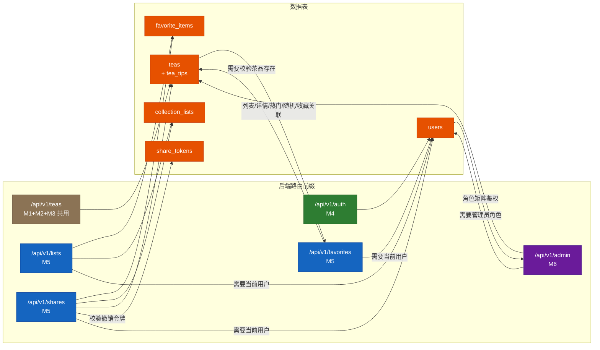

# 茶·图鉴 —— 模块设计文档

| 项 | 值 |
|---|---|
| 文档版本 | v1.0（架构定稿） |
| 创建日期 | 2026-11-05 |
| 分析依据 | [PRD.md](../product/PRD.md) v1.1 · [TECH_STACK.md](./TECH_STACK.md) v1.0 · [ARCHITECTURE.md](./ARCHITECTURE.md) v1.0 |
| 范围边界 | **仅覆盖 MVP（PRD §2.1）**；S1–S17 第二阶段一律不纳入模块划分 |

---

## 1. 模块总览与映射

### 1.1 MVP 六模块映射表

> **关键说明**：业务模块与后端 router 不是一对一。PRD 明确指出——首页 / 列表 / 详情三个业务模块共用 `teas` 后端路由（六个端点覆盖三个前端页面）。
>
> **编号说明**：本文 M1–M6 对应 PRD §5 的"模块 1–6"；PRD §2.1 的 M1（数据模型）是全局数据契约、不单列模块，本文 M1–M6 依次对应 PRD §2.1 的 M2–M7。

| # | 业务模块（PRD） | 后端 router 前缀 | 主要 REST 端点 | 前端路由/页面 | 主要数据表 |
|---|---|---|---|---|---|
| M1 | 茶品列表页 + 筛选 | `/api/v1/teas` | `GET ""`（列表+筛选+排序+分页）、`GET /categories`、`GET /origins` | `/teas` · TeaListView | `teas` |
| M2 | 首页 | `/api/v1/teas` | `GET /hot`（热门推荐）、`GET /random`（随机发现）、`GET /categories`（七大茶类计数） | `/` · HomeView | `teas` |
| M3 | 茶品详情页 | `/api/v1/teas` | `GET /{tea_id}`（详情 + 小贴士 + 冲泡教程） | `/teas/:id` · TeaDetailView | `teas` + `tea_tips` + `tea_brewing_guides` |
| M4 | 注册登录 + 个人中心 | `/api/v1/auth` + `/api/v1/me` | `GET /auth/username-availability`、`POST /auth/register`、`POST /auth/login`、`POST /auth/logout`、`GET /auth/me`、`PUT /auth/password`；`GET /me/stats`、`POST /me/avatar`、`PUT /me/avatar` | 登录模态框（HomeView/MyListView/TeaDetailView 触发）、`/admin/login` · AdminLogin、`/profile` · ProfileView | `users` + `operation_logs` |
| M5 | 收藏清单 + 品鉴笔记 + 分享链接 | `/api/v1/favorites` + `/api/v1/lists` + `/api/v1/shares` | 见 §4 完整端点表 | `/my` · MyListView、`/c/:shareId` · ShareView | `collection_lists` + `favorite_items` + `share_tokens` + `users`（外键）+ `teas`（外键） |
| M6 | 管理员后台（数据维护） | `/api/v1/admin` | 见 §4 完整端点表 | `/admin` · AdminLayout + 子路由（Dashboard / Teas / TeaEdit） | `teas` + `tea_tips` + `tea_brewing_guides` + `users`（角色） |

### 1.2 模块依赖图（graph LR）



### 1.3 依赖层次说明

| 层次 | 模块 | 说明 |
|---|---|---|
| **叶子（无入边，可独立先做）** | AUTH（注册登录）、ADMIN（管理员录入数据） | AUTH 只依赖 `users` 表；ADMIN 只依赖 `teas` 表（先录数据才能被其他模块消费） |
| **基础（被多方复用）** | TEAS（茶品数据） | 首页、列表、详情、收藏、分享全依赖 `teas` 表 |
| **业务（组合基础 + 鉴权）** | FAV / LSTS / SHARE | 依赖 TEAS 校验茶品 + AUTH 提供当前用户身份 |

**无循环依赖**。若后续出现"模块 A 调模块 B，模块 B 又调模块 A"的隐患，解法：抽 `app/services/helpers.py` 作为公共服务层（如"校验用户是否拥有某茶品收藏"这类逻辑抽出来，双方都调 helper）。

---

## 2. 逐模块详细设计

### M1 · M2 · M3 共用 `/api/v1/teas` 路由

> 三个前端页面（首页 HomeView、列表 TeaListView、详情 TeaDetailView）共用同一个后端路由前缀，六个端点覆盖三个页面的全部 REST 需求。

| 端点 | 方法 | 路径 | 入参 | 出参 | 角色 |
|---|---|---|---|---|---|
| 列表+筛选+排序+分页 | GET | `/api/v1/teas` | `category=`（支持逗号多选，如 `green,oolong`）、`origin=`（逗号多选）、`season=`（逗号多选）、`sort=`（`newest` / `favorite`）、`keyword=`（name/origin LIKE）、`page=`（默认 1）、`page_size=`（默认 12，max 50） | `{ items: TeaListItem[], total: number, page: number, page_size: number }` | 游客 / 用户 / 管理员 |
| 七大茶类计数 | GET | `/api/v1/teas/categories` | 无 | `[{ category: "green", count: 18 }, ...]`（七大茶类顺序固定，缺失返回 0） | 游客 / 用户 / 管理员 |
| 产地列表 | GET | `/api/v1/teas/origins` | 无 | `[{ origin: "浙江", count: 8 }, ...]`（**省级名称**，从 `teas.origin` 第一段派生） | 游客 / 用户 / 管理员 |
| 热门推荐 | GET | `/api/v1/teas/hot` | `limit=`（默认 8） | `TeaListItem[]`（按 `favorite_count DESC, created_at DESC`） | 游客 / 用户 / 管理员 |
| 随机发现 | GET | `/api/v1/teas/random` | `exclude_id=`（当前页茶品，避免重复） | `TeaResponse` 或 null | 游客 / 用户 / 管理员 |
| 详情（含小贴士） | GET | `/api/v1/teas/{tea_id}` | path `tea_id: int` | `TeaResponse`（含 `tips_history` 等四个小贴士字段） | 游客 / 用户 / 管理员 |

**关键业务规则（Service 层）**：

| 规则 | 落点 |
|---|---|
| AND 筛选 + 同维度 OR | `services/teas_service.list_teas()`：`WHERE category IN (...) AND origin IN (...) AND season IN (...)` |
| 茶品已下架 → 列表/热门/随机隐藏 | `WHERE is_active = true` 自动附加；详情页单独抛 `TeaOffShelf` |
| 详情页小贴士空字段 → 前端隐藏 | Service 返回完整 Pydantic，前端通过 `v-if="tea.tips_history"` 决定展示 |
| 随机发现 `ORDER BY RAND()` | MVP 数据量 < 1000 行可用，Repository 层实现 |

**涉及数据表**：`teas` + `tea_tips`（JOIN 取小贴士）+ `tea_brewing_guides`（JOIN 取分步教程）

---

### M4 · 注册登录 `/api/v1/auth`

| 端点 | 方法 | 路径 | 入参 | 出参 | Cookie | 角色 |
|---|---|---|---|---|---|---|
| 用户名可用性查询 | GET | `/api/v1/auth/username-availability?username=` | query `username` | `{ username, available: boolean }`（占用返回 `available=false`，非错误） | — | 游客 |
| 注册 | POST | `/api/v1/auth/register` | `{ username: string, password: string }` | `User 对象 { id, username, role, created_at }` | Set-Cookie `tea_session`（30 天） | 游客 |
| 登录 | POST | `/api/v1/auth/login` | `{ username: string, password: string }` | `User 对象 { id, username, role, created_at }` | Set-Cookie `tea_session`（30 天） | 游客 |
| 退出登录 | POST | `/api/v1/auth/logout` | 无 | `{ code: 0, message: "ok" }` | Delete-Cookie `tea_session` | 已登录 |
| 获取当前用户 | GET | `/api/v1/auth/me` | 无（Cookie 自动携带） | `User 对象 { id, username, role, created_at }` | — | 已登录 |
| 修改密码 | PUT | `/api/v1/auth/password` | `{ old_password, new_password }` | `{ code: 0, message: "ok", data: null }` | Delete-Cookie `tea_session` | 已登录 |

**关键业务规则**：

| 规则 | 落点 |
|---|---|
| 用户名实时唯一性校验 | 前端 `Debounce` 调 `GET /auth/username-availability?username=`（大小写不敏感）；注册提交时后端仍二次校验，冲突返回 40910 |
| bcrypt 密码哈希（PRD 4.3） | `core/security.py` `hash_password()` → bcrypt cost=10 |
| 签名 Cookie 会话 | `core/security.py` `create_session_token()` → itsdangerous URLSafeTimedSerializer → `max_age=30*86400`；载荷 `{uid, sv}` |
| 改密吊销旧会话（S-10） | `services/auth.py` `change_password()`：校验旧密码 → 更新 `password_hash` → `users.session_version + 1`（同事务）；`core/auth_deps.py` 比对 `sv` 不一致返回 40100 |
| 登录后回到触发页（FR-4.1） | 前端处理：注册/登录成功后，检查 `localStorage.pending_action`（由"想收藏但未登录"时写入），执行后清除 |
| 管理员初始账号 | 后端启动时检查 `users` 表是否有 `role=admin`，无则自动创建（配置在 `core/config.py`） |

**涉及数据表**：`users`

**权限矩阵落点**：本模块是全部后续模块鉴权的前置依赖——`core/auth_deps.py` 的 `get_current_user` 从 Cookie 解析 `user_id`，注入到后续所有需要登录的路由。

---

### M5 · 收藏清单 + 品鉴笔记 + 分享链接

涉及三个路由前缀 + 多个 Service。

#### 5.1 `/api/v1/favorites`（收藏操作）

| 端点 | 方法 | 路径 | 入参 | 出参 | 角色 |
|---|---|---|---|---|---|
| 收藏 | POST | `/api/v1/favorites/{tea_id}` | path `tea_id`（Cookie 自动携带 user_id） | `{ favorite_count: number }`（茶品最新收藏数，便于前端更新按钮状态） | 用户 / 管理员 |
| 取消收藏 | DELETE | `/api/v1/favorites/{tea_id}` | path `tea_id` | `{ favorite_count: number }` | 用户 / 管理员 |
| 某茶品是否已收藏 | GET | `/api/v1/favorites/{tea_id}/status` | path `tea_id` | `{ is_favorited: boolean, favorite_count: number }` | 用户 / 管理员 |

#### 5.2 `/api/v1/lists`（清单 + 品鉴笔记）

| 端点 | 方法 | 路径 | 入参 | 出参 | 角色 |
|---|---|---|---|---|---|
| 获取我的默认清单 | GET | `/api/v1/lists` | 无 | `{ id, title, tea_count, created_at, updated_at, share: ShareBrief \| null, items: ListItem[] }` | 用户 / 管理员 |
| 更新清单标题 | PUT | `/api/v1/lists/title` | `{ title: string }` | `{ id, title, updated_at }` | 清单所有者 |
| 保存品鉴笔记 | PUT | `/api/v1/lists/notes/{tea_id}` | path `tea_id` + body `{ content: string \| null }`（≤20,000 字符） | `{ tea_id: number, tasting_note: string \| null }` | 清单所有者 |

> 清单条目移除不单独提供 `DELETE /lists/{tea_id}`，统一复用 `DELETE /favorites/{tea_id}`（API_CONTRACT §3）。

#### 5.3 `/api/v1/shares`（分享链接）

| 端点 | 方法 | 路径 | 入参 | 出参 | 角色 |
|---|---|---|---|---|---|
| 生成分享链接 | POST | `/api/v1/shares/generate` | 无（标题取 `collection_lists.title`；已有生效令牌则复用，此时 `is_new=false`） | `{ token, url, created_at, is_new }`（token 为 8 位短码如 `k7X9m2Qa`，url 为 `/c/{token}`） | 清单所有者 |
| 撤销分享 | POST | `/api/v1/shares/revoke/{token}` | path `token` | `{ token, is_active: false, revoked_at }` | 清单所有者 |
| 查看公开分享清单 | GET | `/api/v1/shares/{token}` | path `token`（**无需 Cookie 鉴权**） | `{ token, title, tea_count, created_at, revoked, is_owner, items: ShareViewItem[] }`（**绝不含 `tasting_note`**；已撤销也返回 200：`revoked=true`、`items=[]`） | 游客 / 用户 / 管理员（只读） |
| 一键收藏全部 | POST | `/api/v1/shares/{token}/copy` | path `token` + Cookie 携带当前用户 | `{ added: number, skipped: number, total: number }`（已收藏与已下架的计入 skipped） | 登录用户 / 管理员（**不含清单所有者自己**） |

**关键业务规则（Service 层）**：

| 规则 | 落点 |
|---|---|
| 默认清单自动创建 | 用户首次调用 `/api/v1/lists` 时，`favorites_service.get_or_create_default_list()` 在 `collection_lists` 中按 `user_id` 查找，无则创建标题"我的收藏"（`UNIQUE(user_id)` 兜底并发，唯一冲突按"已存在"处理） |
| 收藏唯一性 | `favorite_items` 表唯一约束 `(user_id, tea_id)`，Service 层调用 Repository 前先查是否已存在，避免 409 冲突 |
| 收藏后更新 `teas.favorite_count` | Repository 层事务内 `UPDATE teas SET favorite_count = favorite_count ± 1 WHERE id = ?` |
| 清单中茶品下架 → 灰显占位 | Repository 层 JOIN 查 `teas.is_active`，返回的 ListItem 加 `is_available` 字段 |
| 分享令牌生成 | `secrets.token_urlsafe(5)` 生成 8 字符短码，查重直到唯一 |
| 分享撤销不可逆 | `UPDATE share_tokens SET is_active = false, revoked_at = NOW() WHERE token = ?` |
| 一键收藏全部跳过已存在 | 先 SELECT 已收藏 `tea_id` 集合 → 求差集 → 批量 INSERT，返回 `added` / `skipped` / `total`；唯一索引 `(user_id, tea_id)` 兜底并发（不用 `INSERT IGNORE`，避免吞掉外键等其他错误） |
| 一键收藏排除清单所有者 | Service 层检查 `share_tokens.list_id → collection_lists.user_id != current_user.id` |

**涉及数据表**：`collection_lists`（清单标题/归属）+ `favorite_items` + `share_tokens`（挂 `list_id`）+ `teas`（外键 + favorite_count 递增/递减）+ `users`（外键）

---

### M6 · 管理员后台 `/api/v1/admin`

| 端点 | 方法 | 路径 | 入参 | 出参 | 角色 |
|---|---|---|---|---|---|
| 新增茶品 | POST | `/api/v1/admin/teas` | TeaCreateRequest（含 MVP 必填+选填全部字段 + 小贴士四区） | `{ id: number, ...TeaResponse }` | 管理员 |
| 茶品详情（管理视角） | GET | `/api/v1/admin/teas/{tea_id}` | path `tea_id` | `TeaDetail`（`is_active` 可能为 false） | 管理员 |
| 编辑茶品 | PUT | `/api/v1/admin/teas/{tea_id}` | 茶品主体字段（同新增，**不接受 `tips_*`**） | `{ id: number, ...TeaResponse }`（`tips_*` 保持原值） | 管理员 |
| 编辑官方小贴士 | PUT | `/api/v1/admin/teas/{tea_id}/tips` | `{ tips_history?, tips_suitable?, tips_misconception?, tips_official_note? }`（省略=保持，`null`=清空） | `{ tea_id, tips_history, tips_suitable, tips_misconception, tips_official_note }` | 管理员 |
| 保存冲泡教程 | PUT | `/api/v1/admin/teas/{tea_id}/brewing-guide` | `{ intro?, steps[3–8], caution? }`（整篇覆盖，ADR-0005） | `{ tea_id, intro, steps, caution }` | 管理员 |
| 删除冲泡教程 | DELETE | `/api/v1/admin/teas/{tea_id}/brewing-guide` | 无（幂等） | `{ tea_id, deleted }` | 管理员 |
| 上下架 | PATCH | `/api/v1/admin/teas/{tea_id}/toggle` | 无 | `{ id, is_active: boolean, updated_at }` | 管理员 |
| 茶品列表（管理视角） | GET | `/api/v1/admin/teas` | `category` / `keyword` / `sort` / 分页 + `is_active`（省略=全部，`true`=仅上架，`false`=仅下架） | `{ items: AdminTeaListItem[], total, page, page_size }`（含下架茶品） | 管理员 |
| 仪表盘统计 | GET | `/api/v1/admin/stats` | 无 | `{ total_count, active_count, inactive_count, category_distribution }` | 管理员 |
| 图片上传 | POST | `/api/v1/admin/upload` | `multipart/form-data file=<UploadFile>` | `{ url, original_filename, size, content_type }`（url 为同源相对路径，如 `/uploads/2026/11/uuid.jpg`） | 管理员 |

**关键业务规则**：

| 规则 | 落点 |
|---|---|
| 管理员权限校验 | `Depends(get_admin_user)`：`users.role == "admin"`，注入到所有 `/api/v1/admin/*` 路由 |
| 茶品下架 → 前端隐藏 | Repository 层 `WHERE is_active = true` 自动加在全部前台查询；后台列表单独跳过 |
| 小贴士空字段保存 | 直接存 null，前端渲染时 `v-if="tea.tips_history"` 决定展示 |
| 图片上传安全 | `python-magic` 校验 MIME 类型；限制 ≤ 5MB；文件名 UUID；存 `uploads/{year}/{month}/{uuid}.{ext}` |

**涉及数据表**：`teas` + `tea_tips` + `users`（角色校验）

---

## 3. 角色矩阵落点

> PRD §3.2 的权限矩阵在各模块的落点：

| PRD 权限 | 落点（Service 层 / 前端路由守卫） |
|---|---|
| 游客：浏览茶品 / 使用筛选 / 查看公开分享清单 | `Router` 不加 `get_current_user` 依赖，任何人可访问 |
| 游客：收藏 ❌ / 写笔记 ❌ / 分享 ❌ | 前端路由守卫：`meta.requiresAuth` → 检查 `localStorage.tea_user`；未登录则弹面板 |
| 注册用户：收藏 / 写笔记 / 分享 / 访问清单 | `Depends(get_current_user)` 注入 user_id |
| 注册用户：一键收藏公开清单 / 撤销自己的分享 | Service 层 `share_service` 检查 `share.token.user_id != current_user.id`（一键收藏）或 `==`（撤销） |
| 管理员：新增/编辑/上下架/发布小贴士 | `Depends(get_admin_user)` → 检查 `users.role == "admin"` |
| 管理员后台路由段 `/admin` | Vue Router 守卫 `meta.requiresAdmin` |

---

## 4. 完整 REST 端点表汇总

> 下表保留 MVP 首批端点映射（原 29 个）与本批新增的 `/api/v1/me`；**完整端点清单与字段以 API_CONTRACT v1.11 为准（当前 60 个）**，不包含第二阶段预留；`GET /api/v1/health` 为部署探针，不在此表。

### `/api/v1/teas`（6 个）

| # | 方法 | 路径 | 业务模块 |
|---|---|---|---|
| 1 | GET | `/` | M1 列表筛选 |
| 2 | GET | `/categories` | M2 首页七大茶类 |
| 3 | GET | `/origins` | M1 筛选面板产地 |
| 4 | GET | `/hot` | M2 首页热门推荐 |
| 5 | GET | `/random` | M2 首页随机发现 |
| 6 | GET | `/{tea_id}` | M3 详情页 |

### `/api/v1/auth`（5 个）

| # | 方法 | 路径 | 业务模块 |
|---|---|---|---|
| 7 | GET | `/username-availability` | M4 用户名实时唯一校验 |
| 8 | POST | `/register` | M4 注册 |
| 9 | POST | `/login` | M4 登录 |
| 10 | POST | `/logout` | M4 退出 |
| 11 | GET | `/me` | M4 获取当前用户 |

### `/api/v1/me`（3 个）

| # | 方法 | 路径 | 业务模块 |
|---|---|---|---|
| 11-1 | GET | `/stats` | M4 个人统计与等级 |
| 11-2 | POST | `/avatar` | M4 上传头像（ADR-0004） |
| 11-3 | PUT | `/avatar` | M4 选择预置头像（ADR-0004） |

### `/api/v1/favorites`（3 个）

| # | 方法 | 路径 | 业务模块 |
|---|---|---|---|
| 12 | POST | `/{tea_id}` | M5 收藏 |
| 13 | DELETE | `/{tea_id}` | M5 取消收藏 |
| 14 | GET | `/{tea_id}/status` | M5 是否已收藏 |

### `/api/v1/lists`（3 个）

| # | 方法 | 路径 | 业务模块 |
|---|---|---|---|
| 15 | GET | `/` | M5 获取默认清单 |
| 16 | PUT | `/title` | M5 更新清单标题 |
| 17 | PUT | `/notes/{tea_id}` | M5 保存品鉴笔记 |

> 清单条目移除不单独提供 `DELETE /lists/{tea_id}`，统一复用 `DELETE /favorites/{tea_id}`（API_CONTRACT §3）。

### `/api/v1/shares`（4 个）

| # | 方法 | 路径 | 业务模块 |
|---|---|---|---|
| 18 | POST | `/generate` | M5 生成分享 |
| 19 | POST | `/revoke/{token}` | M5 撤销分享 |
| 20 | GET | `/{token}` | M5 公开查看（无鉴权） |
| 21 | POST | `/{token}/copy` | M5 一键收藏 |

### `/api/v1/admin`（8 个）

| # | 方法 | 路径 | 业务模块 |
|---|---|---|---|
| 22 | GET | `/teas` | M6 管理视角列表（含下架） |
| 23 | GET | `/teas/{tea_id}` | M6 管理视角详情（含下架） |
| 24 | POST | `/teas` | M6 新增茶品 |
| 25 | PUT | `/teas/{tea_id}` | M6 编辑茶品（不含 tips_*） |
| 26 | PATCH | `/teas/{tea_id}/toggle` | M6 上下架 |
| 27 | PUT | `/teas/{tea_id}/tips` | M6 官方小贴士编辑 |
| 28 | GET | `/stats` | M6 仪表盘 |
| 29 | POST | `/upload` | M6 图片上传 |

**MVP 总计：29 个 REST 业务端点**（另有 `GET /api/v1/health` 部署探针）

---

## 5. 典型数据流时序图（sequenceDiagram）

> 主旅程：注册登录 → 列表页三维度 AND 筛选 → 收藏一款茶 → 生成分享链接 → 未登录访客打开 `/c/{shareId}`

```mermaid
sequenceDiagram
    participant Vue as Vue 组件<br/>(HomeView/TeaListView)
    participant Pinia as Pinia Store<br/>(user/tea)
    participant Axios as Axios 实例<br/>(拦截器)
    participant Router as FastAPI Router
    participant Service as Service 层<br/>(auth/favorites/teas/shares)
    participant Repo as Repository 层
    participant MySQL as MySQL 5.7

    rect rgb(139, 115, 85)
    Note over Vue,MySQL: ① 注册登录（模块 M4）
    Vue->>Vue: 触发登录面板 fill 输入
    Vue->>Axios: POST /api/v1/auth/register {username, password}
    Axios->>Router: POST /auth/register
    Router->>Service: register(db, username, password)
    Service->>Repo: auth_repo.get_by_username(db, username)
    Repo->>MySQL: SELECT * FROM users WHERE username=?
    MySQL-->>Repo: null（无冲突）
    Service->>Service: hash_password(password) ← bcrypt
    Service->>Repo: auth_repo.insert(db, User(...))
    Repo->>MySQL: INSERT INTO users
    MySQL-->>Repo: user_id
    Service-->>Router: User 对象
    Router->>Router: create_session_token(user.id) ← itsdangerous
    Router-->>Axios: {code:0, data:{id, username, role, created_at}}<br/>+ Set-Cookie: tea_session=xxx
    Axios->>Pinia: userStore.hydrate() → user = {id, username}
    Pinia-->>Vue: userStore.isLoggedIn = true
    Vue->>Vue: 关闭面板，执行 pending_action<br/>(由"想收藏但未登录"预写入 localStorage)
    end

    rect rgb(2, 136, 209)
    Note over Vue,MySQL: ② 列表页三维度 AND 筛选（模块 M1）
    Vue->>Pinia: teaStore.fetchList({category:"green",origin:"浙江",sort:"newest",page:1})
    Pinia->>Axios: GET /api/v1/teas?category=green&origin=浙江&sort=newest&page=1
    Axios->>Router: GET /teas
    Router->>Service: list_teas(db, params)
    Service->>Repo: tea_repo.list_with_filter(db, filters)
    Repo->>MySQL: SELECT ... FROM teas WHERE is_active=1<br/>AND category="green" AND origin LIKE "浙江%"<br/>ORDER BY created_at DESC LIMIT 12 OFFSET 0
    MySQL-->>Repo: rows[] + count
    Repo-->>Service: ORM objects[] + total
    Service->>Service: ORM → Pydantic TeaListItem.model_dump()
    Service-->>Router: TeaListResponse
    Router-->>Axios: {code:0, data:{items:[...], total:18, page:1}}
    Axios->>Pinia: teaStore.list = items
    Pinia-->>Vue: 渲染卡片视图
    end

    rect rgb(34, 139, 34)
    Note over Vue,MySQL: ③ 收藏一款茶（模块 M5）
    Vue->>Pinia: teaStore.fetchDetail(teaId=5) → 渲染详情页，显示 ❤️ 未收藏
    Vue->>Axios: POST /api/v1/favorites/5<br/>Cookie: tea_session=xxx ← HttpOnly Cookie 自动携带
    Axios->>Router: POST /favorites/{tea_id} (Depends(get_current_user) 解析 Cookie → user_id)
    Router->>Service: favorite_service.toggle(db, user_id, tea_id)
    Service->>Repo: favorite_repo.exists(db, user_id, tea_id)
    Repo->>MySQL: SELECT 1 FROM favorite_items WHERE user_id=? AND tea_id=?
    MySQL-->>Repo: null（未收藏）
    Service->>Repo: favorite_repo.insert(db, FavoriteItem(user_id, tea_id))
    Repo->>MySQL: INSERT INTO favorite_items
    Service->>Repo: tea_repo.increment_favorite_count(db, tea_id)
    Repo->>MySQL: UPDATE teas SET favorite_count = favorite_count + 1 WHERE id = 5
    MySQL-->>Repo: affected rows
    Service-->>Router: { favorite_count: 13 }
    Router-->>Axios: {code:0, data:{favorite_count:13}}
    Axios-->>Vue: ElMessage.success("收藏成功")
    Vue->>Vue: ❤️ 按钮变实心 "已收藏"
    end

    rect rgb(204, 99, 32)
    Note over Vue,MySQL: ④ 生成分享链接（模块 M5）
    Vue->>Axios: POST /api/v1/shares/generate<br/>Cookie: tea_session=xxx
    Axios->>Router: POST /shares/generate (get_current_user → user_id)
    Router->>Service: share_service.generate(db, user_id)
    Service->>Service: secrets.token_urlsafe(5) → "k7X9m2Qa"
    Service->>Repo: share_repo.insert(db, ShareToken(list_id, token="k7X9m2Qa", ...))
    Repo->>MySQL: INSERT INTO share_tokens
    Service-->>Router: { token: "k7X9m2Qa", url: "/c/k7X9m2Qa", created_at, is_new: true }
    Router-->>Axios: {code:0, data:{token, url}}
    Axios-->>Vue: 弹出分享面板，显示完整 URL
    end

    rect rgb(123, 31, 162)
    Note over Vue,MySQL: ⑤ 未登录访客打开分享链接 /c/k7X9m2Qa
    actor Guest as 访客浏览器
    Guest->>Axios: GET /api/v1/shares/k7X9m2Qa<br/>（无 Cookie，纯 GET）
    Axios->>Router: GET /shares/{token} ← **无 get_current_user 依赖**（公开端点）
    Router->>Service: share_service.view(db, token)
    Service->>Repo: share_repo.get_by_token(db, token)
    Repo->>MySQL: SELECT * FROM share_tokens WHERE token="k7X9m2Qa" AND is_active=1
    MySQL-->>Repo: row
    Service->>Repo: list_repo.get_by_id(db, share_token.list_id)
    Repo->>MySQL: SELECT * FROM collection_lists WHERE id=?
    MySQL-->>Repo: row（取清单标题与所有者 user_id）
    Service->>Repo: favorite_repo.list_by_user(db, list.user_id)
    Repo->>MySQL: SELECT * FROM favorite_items WHERE user_id=?
    MySQL-->>Repo: rows[]
    Service->>Repo: tea_repo.get_multi(db, tea_ids[])
    Repo->>MySQL: SELECT * FROM teas WHERE id IN (5, 12, 3)
    MySQL-->>Repo: rows[]
    Service->>Service: 拼装公开清单 JSON（不含私有字段如笔记内容）
    Service-->>Router: ShareViewResponse
    Router-->>Axios: {code:0, data:{title:"我的收藏", tea_count:3, revoked:false, is_owner:false, items:[...]}}
    Axios-->>Guest: 渲染只读清单
    end

    rect rgb(244, 67, 54)
    Note over Axios,Guest: 错误处理链路
    alt Token 不存在
        Router->>MySQL: 查不到 token
        MySQL-->>Router: no rows
        Router->>Router: 抛 ShareNotFound
        Router-->>Axios: HTTP 404 {code:40410, message:"该分享已被撤销或不存在"}
        Axios-->>Guest: ElMessage.error("该分享已被撤销或不存在")
    else Token 已撤销（is_active=false）
        Router-->>Axios: HTTP 200 {code:0, data:{revoked:true, items:[]}}
        Axios-->>Guest: 展示"该分享已被撤销"占位页（非错误 Toast）
    else Tea 已下架
        Repo->>MySQL: WHERE is_active=1 不匹配
        Repo-->>Axios: 空 rows
        Axios-->>Guest: 前端灰显占位 "该茶品暂不可用"
    end
```

### 5.1 逐跳标注

| 环节 | 执行层 | 说明 |
|---|---|---|
| Cookie 携带 | Axios 拦截器 | `withCredentials: true` → 所有同源请求自动携带 `tea_session` |
| 登录态校验 | Router 层（FastAPI Depends） | `get_current_user` 从 Cookie 解析 → 返回 user_id 注入到后续 Service |
| 管理员角色校验 | Router 层（FastAPI Depends） | `get_admin_user` 在 `users.role == "admin"` 时返回，否则抛 403 |
| 业务规则执行 | Service 层 | AND 筛选拼接、收藏唯一性检查、分享令牌查重、一键收藏跳过已存在 |
| 数据访问 | Repository 层 | 纯 SQLAlchemy 查询，无业务判断 |
| 错误码转 Toast | Axios 响应拦截器 | 后端返回 `code != 0` → ElMessage.error(message) |
| HTTP 层错误 | Axios 响应拦截器 | 401 → "登录已过期"；404 → 按 message 提示；network error → "网络异常" |
| 分享令牌校验 | Service 层（share_service.view） | 查 `share_tokens` 表：token 不存在抛 `ShareNotFound`（40410）；`is_active=false` 不抛错，返回 `revoked=true` 正常响应（HTTP 200） |

### 5.2 典型错误场景覆盖

| 场景 | 后端抛出 | HTTP 状态码 | 错误码 | 前端 Toast 文案 |
|---|---|---|---|---|
| 用户名已存在 | `UsernameExists` | 409 | 40910 | "用户名已存在" |
| 密码错误 | `BadCredentials` | 401 | 40110 | "用户名或密码错误" |
| 茶品不存在 | `TeaNotFound` | 404 | 40400 | "茶品不存在" |
| 茶品已下架 | `TeaOffShelf` | 404 | 40401 | "该茶品暂不可用" |
| 分享不存在 | `ShareNotFound` | 404 | 40410 | "该分享已被撤销或不存在" |
| 查看已撤销的分享 | 不抛错（`revoked=true` 正常响应） | 200 | 0 | 展示"该分享已被撤销"占位页 |
| 再次撤销 / 一键收藏已撤销令牌 | `ShareAlreadyRevoked` | 409 | 40900 | "该分享已被撤销" |
| 未登录 | Router 抛 HTTPException | 401 | 40100 | "登录已过期，请重新登录" |
| 无管理员权限 | `UserForbidden` | 403 | 40300 | "无权限执行此操作" |
