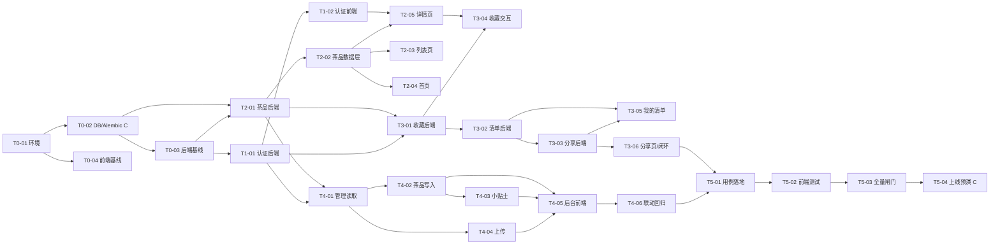

# 茶·图鉴 —— MVP 开发计划（PLANS）

| 项 | 值 |
|---|---|
| 文档版本 | v1.1（已按用户答复更新决策项） |
| 创建日期 | 2026-11-07 |
| 最近更新 | 2026-11-07 |
| 适用范围 | MVP（PRD §2.1 的 M1–M7 / 29 个业务端点 / 60 条测试用例） |
| 依据 | [PRD.md](../product/PRD.md) v1.1 · [TECH_STACK.md](../architecture/TECH_STACK.md) v1.0 · [ARCHITECTURE.md](../architecture/ARCHITECTURE.md) v1.0 · [MODULE_DESIGN.md](../architecture/MODULE_DESIGN.md) v1.0 · [DATA_MODEL.md](../architecture/DATA_MODEL.md) v1.0 · [API_CONTRACT.md](../api/API_CONTRACT.md) v1.0 · [SECURITY.md](../architecture/SECURITY.md) v1.0 · [DESIGN_SYSTEM.md](../design/DESIGN_SYSTEM.md) · [PAGE_SPECS.md](../design/PAGE_SPECS.md) · [TEST_PLAN.md](../testing/TEST_PLAN.md) v1.0 · [DEVELOPMENT_GUIDE.md](./DEVELOPMENT_GUIDE.md) · [AGENTS.md](../../AGENTS.md) |
| 定位 | **任务编排与验收计划**，不替代任何权威文档；规则冲突时以 PRD / API_CONTRACT / SECURITY 为准 |
| 状态 | 计划已定稿待执行 · **当前按用户指示只完善计划，不编码** · 执行节奏由用户逐阶段下达 |

---

## 0. 使用说明

1. 本计划只回答"**先做什么、做到什么程度、怎么验收**"；具体规则仍以 §1 依据文档为准。
2. 每个任务执行前必须按 [TASK_TEMPLATE.md](../../harness/TASK_TEMPLATE.md) 填写任务卡并定级（A/B/C/D）。
3. 本计划中的"默认分级"是初判；执行中发现契约/表结构/安全项需要变更，立即停止并升级为 C 类。
4. 阶段之间设**出口闸门**：上一阶段验收未通过，不进入下一阶段。
5. 测试结果只写实跑证据；未运行写「未运行」。
6. 用户已于 2026-11-07 明确：**暂不编码，继续完善本计划**；计划确认与开工指令分离。

### 0.1 决策状态（2026-11-07 更新）

| 编号 | 事项 | 用户答复 | 计划处理 |
|---|---|---|---|
| D1 | 是否将"失物拾物/认领"替换为"茶品发现/收藏分享" | **已认可** | 阶段 2–3 按茶品域执行，不再保留失物域任务 |
| D2 | Alembic 基线迁移是否现在建立 | **后续再定** | T0-02 拆为"建库 + init.sql"（可先做）与"Alembic 基线"（待定，不阻塞计划完善） |
| D3 | 阶段完成后是否自动推进 | **由用户逐阶段告知** | 取消"默认连续推进"，每个阶段出口后等待指令 |
| D4 | 本地数据库环境 | **MySQL 已安装，但无数据库** | T0-02 负责从零创建 `tea_guide` 与 `tea_guide_test`，不使用 SQLite 替代 |
| D5 | 当前是否编码 | **不编码** | 本版本仅完善计划；开工需用户另行下达指令 |

> 决策只影响编排与前置条件，不改变任何业务规则、API 契约、表结构或安全控制。

---

## 1. 编排原则

### 1.1 范围口径

| 项 | 口径 |
|---|---|
| 业务模块 | PRD §5 的模块 1–6（后台为模块 6） |
| 端点 | **29 个**业务端点（auth 5 / teas 6 / favorites 3 / lists 3 / shares 4 / admin 8），另有 `GET /api/v1/health` 探针 |
| 数据表 | **7 张**：`users` / `teas` / `tea_tips` / `collection_lists` / `favorite_items` / `share_tokens` / `operation_logs` |
| 测试 | TEST_PLAN 60 条（高 32 / 中 25 / 低 3） |
| 明确不做 | PRD §6 的 S1–S17、§2.3 的 X1–X13 |

### 1.2 关于"建议顺序"的口径修正

用户给出的建议顺序中，「**失物拾物、认领业务**」不属于本项目：

- [API_CONTRACT.md](../api/API_CONTRACT.md) §1.12 明确列出"失物、拾物、认领、审核、通知"**不存在对应接口**；
- PRD 的核心闭环是「**发现茶 → 查看详情 → 收藏/写笔记/分享**」。

因此本计划将这两个阶段替换为：

| 建议顺序 | 本计划实际阶段 | 对应 PRD |
|---|---|---|
| 基础环境 | 阶段 0：基础环境与工程基线 | 技术栈 / 架构 |
| 用户认证 | 阶段 1：用户认证与会话 | 模块 4 |
| 失物拾物 → **茶品发现** | 阶段 2：茶品数据与浏览闭环 | 模块 1 / 2 / 3 |
| 认领业务 → **收藏、笔记与分享** | 阶段 3：收藏清单 + 品鉴笔记 + 分享 | 模块 5 |
| 后台管理 | 阶段 4：管理员后台 | 模块 6 |
| 测试交付 | 阶段 5：测试补齐与交付验收 | TEST_PLAN / SECURITY |

### 1.3 三条编排约束

1. **垂直切片优先**：以"游客能浏览 → 用户能登录 → 能收藏 → 能分享"为主线，每个阶段交付可运行、可验收的切片，不做"先把所有表/所有 schema 写完再说"。
2. **数据先行**：有种子数据（`database/init.sql` 6 款茶）即可支撑浏览闭环；管理员后台排在后，避免"数据录入阻塞前台"。
3. **同一时刻只推一条依赖链**：默认 WIP = 1 个任务；仅 §4.2 列出的成对任务允许并行，且不得修改同一文件。

### 1.4 分级闸门（摘录，详见 DEVELOPMENT_GUIDE §2）

| 分级 | 本计划中的典型任务 | 执行要求 |
|---|---|---|
| **A** | 环境配置核对、样式微调、纯函数单测、CI 实跑 | 可直接编码 |
| **B** | 任一端点全链路、任一完整页面、鉴权横切、测试批次 | 先输出技术方案，再编码 |
| **C** | **Alembic 基线迁移**、表/索引/ENUM 变更、上线配置（密钥/DEBUG/管理员密码轮换）、契约变更 | 必须等待用户确认 |
| **D** | S1–S17、X1–X13 | 不开发 |

> 本计划中 **T0-02（数据库与 Alembic 基线）** 与 **T5-04（上线配置预演）** 默认按 C 类处理，需在阶段 0 开始前确认口径。

### 1.5 每任务的统一交付物

| 产出 | 要求 |
|---|---|
| 任务卡 | 按 TASK_TEMPLATE 填写，含分级、来源、验收标准 |
| 代码 | 严格按五层（后端）与前台/后台视觉分离（前端） |
| 测试证据 | 命令 + 范围 + 实际结果；失败/跳过如实写 |
| 文档同步 | 端点/字段/表/安全项变更同步权威文档 |
| build-log | [build-log.md](../../harness/build-log.md) 追加一条 |

---

## 2. 里程碑总览

> 下文用 **G0–G5**（Gate）表示阶段闸门，避免与 PRD 的业务模块编号 M1–M7 混淆。

| 阶段 | 里程碑 | 任务数 | 出口标准（全部满足才进入下一阶段） | 对应闭环 |
|---|---|---:|---|---|
| **G0** 基础环境 | 前后端可启动、数据库可用、错误体统一 | 4 | 健康检查经 Vite 代理可达；7 表与种子就绪；异常/422 响应符合契约；前端请求层可用 | 工程地基 |
| **G1** 用户认证 | 注册/登录/会话/登出可用 | 2 | AUTH 高优先级用例全过；前端登录回流可用 | 身份 |
| **G2** 茶品发现 | 游客可浏览、筛选、搜索、看详情 | 5 | LIST 用例全过；首页/列表/详情三页可用；无硬编码色值 | 「发现茶 → 看详情」 |
| **G3** 收藏与分享 | **MVP 完整业务闭环打通** | 6 | FAV/NOTE/SHARE 高优先级用例全过；端到端脚本通过 | 「收藏/笔记/分享」 |
| **G4** 后台管理 | 管理员可维护数据 | 6 | TEA/PERM/UPLOAD 用例全过；后台 5 页可用；上下架联动正确 | 数据供给 |
| **G5** 测试交付 | 60 条用例落地、全量闸门通过 | 4 | 高 32 条全过；全量静态检查通过；上线清单完成 | 交付 |

> **MVP 闭环里程碑 = G3**。G0–G3 完成即可演示「发现茶 → 详情 → 收藏/写笔记/分享 → 游客打开分享链接」的完整旅程；G4 补齐数据维护能力，G5 补齐证据与交付。

---

## 3. 阶段与任务明细

> 每个任务包含：默认分级 / 目标 / 输入 / 输出 / 涉及模块 / 依赖 / 验收标准 / 测试要求 / 非目标。
> 涉及模块标记：`BE`=后端，`FE`=前端，`DB`=数据库。

### 3.0 任务总索引

| 编号 | 任务 | 主要交付物 | 依赖 | 测试用例 | 分级 |
|---|---|---|---|---|---|
| T0-01 | 工程环境与配置基线 | `.env.example`、Vite 代理、启动冒烟 | — | 冒烟 + check_secrets | A |
| T0-02 | 数据库基线与 Alembic | 两个库、7 表、种子、baseline 迁移 | T0-01 | DB 断言脚本 | C |
| T0-03 | 后端五层与统一错误基线 | `auth_deps`、`repositories/`、异常处理器 | T0-01/02 | DEF-01/03 | B |
| T0-04 | 前端基础设施 | 请求层、自研 Toast、类型/路由骨架 | T0-01 | Vitest + 手工 | B |
| T1-01 | 认证后端 5 端点 | auth 全链路、bcrypt cost=10 | T0-03 | AUTH-01–09、PERM-02 | B |
| T1-02 | 认证前端与登录回流 | 登录模态框、user store、pending_action | T1-01、T0-04 | Vitest + 手工 | B |
| T2-01 | 茶品读取后端 6 端点 | 筛选/分页/软失效/schema 化 | T0-02/03 | LIST-01–09、TEA-06 | B |
| T2-02 | 前端茶品数据层 | `types`、`api/teas`、`stores/tea` | T2-01、T0-04 | Vitest | A |
| T2-03 | 茶品列表页 | 筛选面板、卡片、URL 同步、空态 | T2-02 | Vitest + 手工 | B |
| T2-04 | 首页 | 六入口、热门、随机、搜索建议 | T2-02 | Vitest + 手工 | B |
| T2-05 | 茶品详情页 | 四段描述、tips 隐藏、行动入口 | T2-02、T1-02 | 手工 | B |
| T3-01 | 收藏后端 3 端点 | 收藏/取消/状态、计数事务 | T2-01、T1-01 | FAV-01–07 | B |
| T3-02 | 清单与笔记后端 3 端点 | 默认清单、标题、笔记 | T3-01 | NOTE-01–05、PERM-03 | B |
| T3-03 | 分享后端 4 端点 | 生成/撤销/公开/一键收藏 | T3-01/02 | SHARE-01–10 | B |
| T3-04 | 前端收藏交互 | FavoriteButton、乐观更新回滚 | T3-01、T2-05 | Vitest + 手工 | B |
| T3-05 | 我的清单页 | 标题、条目、笔记、分享面板 | T3-02/03/04 | Vitest + 手工 | B |
| T3-06 | 分享公开页与闭环验收 | ShareView、一键收藏、端到端证据 | T3-03、T3-05 | SHARE-04/05/08/09 | B |
| T4-01 | 管理读取与统计 3 端点 | 含下架列表、详情、统计、门禁 | T2-01、T1-01 | PERM-01/02/04 | B |
| T4-02 | 茶品新增/编辑/上下架 | 写入校验、审计日志、软失效 | T4-01 | TEA-01–07 | B |
| T4-03 | 官方小贴士编辑 | 部分更新语义、空块隐藏 | T4-02 | 实现级 pytest | B |
| T4-04 | 图片上传 | 魔数、大小、UUID、同源 URL | T4-01 | UPLOAD-01–05 | B |
| T4-05 | 后台前端 5 页 | 登录/布局/仪表盘/列表/表单 | T4-02/03/04 | Vitest + 手工 | B |
| T4-06 | 管理变更前台联动回归 | 下架/上架/编辑回归记录 | T4-05 | TEA-06/07、LIST-09 | A |
| T5-01 | TEST_PLAN 全量落地 | conftest、60 条用例、执行表 | G1–G4 完成 | 全部 60 条 | B |
| T5-02 | 前端单测与静态检查 | `*.spec.ts`、四命令结果 | T3-06、T4-05 | Vitest + lint/build | A/B |
| T5-03 | 全量闸门与 CI 实跑 | `check_all.py`、CI 记录 | T5-01/02 | 全量 | A |
| T5-04 | 上线前安全清单与部署预演 | 密钥/密码轮换、Nginx 草案 | G4、T5-03 | DEF-04 | C |

---

### 阶段 0 · 基础环境与工程基线（G0）

#### T0-01 工程环境与配置基线

| 项 | 内容 |
|---|---|
| 默认分级 | **A** |
| 目标（一句话） | 前后端能在本机启动并通过 Vite 同源代理访问后端健康检查，配置项全部来自 `.env`。 |
| 输入 | TECH_STACK §4/§5、ARCHITECTURE §4.1、AGENTS §0.1；现有 `backend/run.py`、`frontend/vite.config.ts` |
| 输出 | `.env.example`（不含真实密钥）、`core/config.py` 必填校验、Vite `/api` 与 `/uploads` 代理、`uploads/` 目录、启动记录 |
| 涉及模块 | `BE` core/config.py、run.py · `FE` vite.config.ts · `DB` 连接串（不建表） |
| 依赖 | 无 |
| 验收标准 | 1. `python run.py` 启动后 `GET /api/v1/health` 返回 200<br>2. `npm run dev` 后 `http://localhost:5173/api/v1/health` 经代理返回相同结果<br>3. 缺少必需配置时启动报错明确，且日志不输出密码/密钥<br>4. `python scripts/check_secrets.py` 通过 |
| 测试要求 | 启动冒烟（两条 curl/浏览器记录）；`check_secrets.py`；无业务用例 |
| 非目标 | 不建表、不实现业务端点、不改 CI |

#### T0-02 数据库基线与 Alembic 迁移（C 类）

| 项 | 内容 |
|---|---|
| 默认分级 | **C**（建库/建表/迁移均属结构基线） |
| 目标 | 从零创建 `tea_guide`（开发/演示）与 `tea_guide_test`（测试）两个库，落地 7 张表、索引与种子；Alembic 基线按 D2 待定。 |
| 输入 | DATA_MODEL §4/§5/§9、`database/init.sql`、ARCHITECTURE §5.4、SECURITY S-32；**本机已安装 MySQL，当前无任何数据库**（D4） |
| 输出 | 建库与应用账号命令（可复跑）、两个库、`init.sql` 执行记录、表/索引/种子核对清单；`alembic/versions/0001_baseline.py`（D2 决定后再产出） |
| 涉及模块 | `DB` database/init.sql、两个 schema · `BE` models、alembic/env.py、versions/ |
| 依赖 | T0-01 |
| 验收标准 | 1. `SHOW DATABASES` 同时存在 `tea_guide` 与 `tea_guide_test`，字符集 `utf8mb4` / 排序规则 `utf8mb4_unicode_ci`<br>2. 两个库各 `SHOW TABLES` 恰为 7 张，索引与 DATA_MODEL §5 一致（含 `uk_share_token`、`token` 为 `utf8mb4_bin`）<br>3. 种子 ≥6 款茶 + 1 个 `role=admin` 账号可查，`favorite_count` 为演示值且不为空<br>4. 应用账号可连接两库并完成 SELECT/INSERT/UPDATE/DELETE；测试库与开发库互不影响<br>5. （D2 选择"建迁移"时）`alembic upgrade head` / `downgrade` 可重复执行；选择"不建迁移"时，ADR 记录"init.sql 即基线" |
| 测试要求 | 数据库断言脚本：库存在性、表数、索引、种子行数、字符集/排序规则；对 `tea_guide_test` 重复执行；无 API 用例 |
| 非目标 | 不新增/修改任何列、索引、ENUM；不改种子业务口径；不使用 SQLite 替代 MySQL |
| 分段执行 | **T0-02a（可先做）**：创建两库与应用账号 → 执行 `init.sql` → 核对 7 表/索引/种子。<br>**T0-02b（待 D2）**：生成 Alembic 基线并验证 upgrade/downgrade；若选择不建迁移，写提议 ADR 并等确认。 |
| C 类说明 | 建库、建表、迁移均需用户确认口径后执行；D2 未定期间可先完成 T0-02a，T0-02b 不阻塞计划完善 |

#### T0-03 后端五层与统一错误基线

| 项 | 内容 |
|---|---|
| 默认分级 | **B**（横切全部端点） |
| 目标 | 补齐 `repositories/`、`core/auth_deps.py`，注册全局异常处理器，统一 422→400/`40000` 与 500/`50000` 响应。 |
| 输入 | ARCHITECTURE §3/§5.4、API_CONTRACT §1.3/§1.4、SECURITY S-19/S-30、AGENTS §13 |
| 输出 | `core/auth_deps.py`（`get_current_user` / `get_admin_user`）、`core/response.py` 补 422/500 handler、`main.py` 注册、`repositories/__init__.py`、分层基线更新 |
| 涉及模块 | `BE` core/、repositories/、main.py |
| 依赖 | T0-01、T0-02 |
| 验收标准 | 1. 任何 `TeaGuideError` 返回 `{code,message,data:null}` 且 `HTTP = code // 100`<br>2. 非法 JSON/字段类型 → 400/`40000`，不泄露 Pydantic 原始结构<br>3. 未捕获异常 → 500/`50000`，响应无堆栈/SQL/表名，服务端日志有堆栈<br>4. `python scripts/check_layers.py` 无新增违规 |
| 测试要求 | `TC-DEF-01`、`TC-DEF-03`；`cd backend; python -m pytest -q`；`python scripts/check_layers.py` |
| 非目标 | 不实现任何业务端点；不批量重构既有 Service（仅额外建目录与被触达文件对齐） |

#### T0-04 前端基础设施

| 项 | 内容 |
|---|---|
| 默认分级 | **B**（影响全部页面的请求与错误处理） |
| 目标 | 建立请求层、类型骨架、路由骨架、自研 Toast，并清除被触达文件中的 Element Plus 依赖。 |
| 输入 | TECH_STACK §4.2–4.4、API_CONTRACT §1.3/§1.5、DESIGN_SYSTEM §5、AGENTS §3.1 |
| 输出 | `api/request.ts`（仅 `code===0` 成功、401 清理会话并派发登录事件）、`stores/toast.ts` 自研、`components/Toast`、`types/` 基础、路由骨架、首个 Vitest 用例 |
| 涉及模块 | `FE` api/、stores/、components/、router/、types/、测试 |
| 依赖 | T0-01（可与 T0-03 并行） |
| 验收标准 | 1. 非 0 `code` 统一 Toast；`401/40100` 清空用户态并触发登录面板<br>2. `request.ts` / `toast.ts` 不再 import Element Plus；前台组件不新增 EP<br>3. `npm run lint`、`npm run typecheck`、`npm run test:run` 通过且至少 1 个 spec |
| 测试要求 | Vitest：错误码判定/登录事件纯函数；手工会话过期冒烟 |
| 非目标 | 不实现业务页面；不改造后台（后台允许 Element Plus） |

**阶段 0 出口**：4 项任务验收通过；数据库/错误体/请求层三项基线在 build-log 留痕。

---

### 阶段 1 · 用户认证与会话（G1）

#### T1-01 认证后端 5 端点

| 项 | 内容 |
|---|---|
| 默认分级 | **B**（跨 schema/repository/service/router） |
| 目标 | 按契约实现 `username-availability` / `register` / `login` / `logout` / `me`，会话使用 HttpOnly Cookie。 |
| 输入 | API_CONTRACT §4.1、SECURITY S-01–S-10、PRD FR-4.1–4.4、TEST_PLAN §5.1 |
| 输出 | `schemas/auth.py` 完整、`repositories/user_repo.py`、`services/auth.py` 下沉、`routers/auth.py`、bcrypt `cost=10`、Cookie 属性、`me` 真实返回 |
| 涉及模块 | `BE` routers/services/repositories/schemas/core · `FE` 由 T1-02 对接 · `DB` users |
| 依赖 | T0-03 |
| 验收标准 | 1. 注册返回 `{id,username,role,created_at}`，`Set-Cookie: tea_session` 具备 HttpOnly / SameSite=Lax / Path=/ / Max-Age=2592000<br>2. 重名（大小写不敏感）→ 409/`40910`；密码错误 → 401/`40110`，两种失败消息一致<br>3. `/auth/me` 无会话 → 401/`40100`；登录/注册成功后可用；登出删除 Cookie<br>4. `password_hash` 形如 `$2b$10$…`，响应与日志无密码明文<br>5. 用户名 3–20、密码 6–64、首尾空格 trim 规则 → `40000` |
| 测试要求 | `TC-AUTH-01`–`TC-AUTH-09`（高 6 条必须全过）、`TC-PERM-02`；命令 `cd backend; python -m pytest -q -k "AUTH or PERM"` |
| 非目标 | 密码错误锁定（S14）、找回密码（X4）、第三方登录（X5）、用户管理（X8） |

#### T1-02 认证前端与登录回流

| 项 | 内容 |
|---|---|
| 默认分级 | **B** |
| 目标 | 提供登录/注册模态框，未登录操作可弹出并在成功后回到触发动作。 |
| 输入 | PAGE_SPECS §八、PRD FR-4.1/4.2、T1-01 契约 |
| 输出 | `components/LoginModal.vue`、`stores/user.ts`、路由守卫、`pending_action` 工具、对应 Vitest |
| 涉及模块 | `FE` components/、stores/、router/、utils/ · `BE` 无新增 |
| 依赖 | T1-01、T0-04 |
| 验收标准 | 1. 未登录点收藏/笔记/分享/我的 → 弹窗，不跳空白页<br>2. 注册/登录成功后自动执行原动作并清理 `pending_action`<br>3. 用户名实时可用性校验（debounce，占用禁用提交）<br>4. 刷新页面后 `/auth/me` 恢复登录态；登出后清空 |
| 测试要求 | Vitest：`pending_action` 读写/路径还原；手工冒烟登录回流；前端 `npm run lint/typecheck/test:run` |
| 非目标 | 不做后台登录页（T4-05）；不做密码找回 |

**阶段 1 出口**：认证高优先级用例全过；前端登录回流手工证据留痕。

---

### 阶段 2 · 茶品数据与浏览闭环（G2）

#### T2-01 茶品读取后端 6 端点

| 项 | 内容 |
|---|---|
| 默认分级 | **B** |
| 目标 | 6 个 `teas` 端点完全对齐契约：筛选/排序/分页/软失效/枚举校验/关键词转义。 |
| 输入 | API_CONTRACT §4.2、MODULE_DESIGN M1–M3、DATA_MODEL teas/tea_tips、TEST_PLAN §5.3 |
| 输出 | `schemas/tea.py`（TeaListItem/TeaDetail/CategoryCount/OriginCount）、`repositories/tea_repo.py`、`services/teas.py` 下沉、`routers/teas.py` 响应 Schema 化 |
| 涉及模块 | `BE` repos/services/schemas/routers · `DB` teas + tea_tips |
| 依赖 | T0-02、T0-03 |
| 验收标准 | 1. 列表返回 `items/total/page/page_size`，默认 `page_size=12`，越界夹取并回显实际值<br>2. 同维度多选 OR、跨维度 AND；非法枚举 → `40000`；无结果 → 200/`code=0` + `items=[]`<br>3. 下架茶不出现在列表/搜索/热门/随机；详情 → 404/`40401`<br>4. `categories` 固定六项顺序且含 `count=0`；`origins` 仅省级、仅统计在架<br>5. `hot` 的 `limit` 夹取到 1–20；`random` 遵守 `exclude_id`，无可选时 `data=null` |
| 测试要求 | `TC-LIST-01`–`TC-LIST-09`、`TC-TEA-06`（公开可见性部分）、`TC-DEF-01`（`page_size`）；命令 `pytest -q -k "LIST or TEA"` |
| 非目标 | 跨维度 OR（S1）、发酵/价格筛选（S2）、对比视图（S3）、多图/视频（S4/S5）、相关推荐（S6） |

#### T2-02 前端茶品数据层

| 项 | 内容 |
|---|---|
| 默认分级 | **A**（纯内部实现，对外行为不变） |
| 目标 | `types/` 与 Schema 一一对应，封装 `api/teas.ts` 与 `stores/tea.ts`。 |
| 输入 | API_CONTRACT §2.2/§2.3、openapi.yaml、T2-01 |
| 输出 | `types/index.ts`（TeaListItem/TeaDetail/CategoryCount/OriginCount/PageResult）、`api/teas.ts`、`stores/tea.ts`（含 loading 去重） |
| 涉及模块 | `FE` types/、api/、stores/ · `BE` 无 |
| 依赖 | T2-01、T0-04 |
| 验收标准 | 1. 字段名/类型与契约逐字一致（`snake_case`）<br>2. 筛选参数组装、分页夹取、排序枚举正确<br>3. 同页重复请求有 loading 防抖 |
| 测试要求 | Vitest：参数组装/夹取/空结果归一；`npm run typecheck` |
| 非目标 | 不实现页面；不改后端 |

#### T2-03 茶品列表页

| 项 | 内容 |
|---|---|
| 默认分级 | **B** |
| 目标 | P2 页面可用：三维筛选、标签移除、排序、分页、URL 双向同步、空态。 |
| 输入 | PAGE_SPECS §四、DESIGN_SYSTEM §4.3/§4.6、`原型/teas/index.html`、T2-02 |
| 输出 | `TeaListView.vue`、`FilterPanel`、`TeaCard`、`EmptyState`；URL 参数同步 |
| 涉及模块 | `FE` views/、components/、styles/ · `BE` 无 · `DB` 无 |
| 依赖 | T2-02 |
| 验收标准 | 1. 筛选 onChange 实时刷新，无需"应用"；已选标签可单独 ×、可清除全部<br>2. `sort=newest/favorite` 生效；显示"共 N 款 / 第 X 页 共 Y 页"<br>3. URL `?category=&origin=&season=&sort=&keyword=&page=` 解析与 `history.replaceState` 双向同步<br>4. 空结果显示"试试调整筛选条件" + 3 款热门引导<br>5. 无硬编码 HEX；前台无 Element Plus |
| 测试要求 | Vitest：筛选组合/URL 编解码纯函数；手工冒烟筛选、分页、空态 |
| 非目标 | 列表视图/对比视图（S3）、无限滚动、OR 切换（S1） |

#### T2-04 首页

| 项 | 内容 |
|---|---|
| 默认分级 | **B** |
| 目标 | P1 页面可用：六大入口、热门轨道、随机发现、搜索建议。 |
| 输入 | PAGE_SPECS §三、PRD 模块 2、`原型/index.html`、T2-02 |
| 输出 | `HomeView.vue`、`CategoryEntry`、`HotRail`、`RandomCard`、`SearchSuggest` |
| 涉及模块 | `FE` views/、components/ · `BE` 无 · `DB` 无 |
| 依赖 | T2-02（可与 T2-03 并行） |
| 验收标准 | 1. 六大入口显示名称 + 计数；计数 0 显示"暂无收录"，点击带 `category` 跳列表<br>2. 热门 8 卡横向滚动，按收藏数降序<br>3. 随机 1 卡 + "换一批"生效<br>4. 搜索建议 ≤6 条、150ms debounce、匹配名称或产地；回车跳列表带 `keyword` |
| 测试要求 | Vitest：搜索建议过滤纯函数；手工冒烟三路径（入口/热门/随机） |
| 非目标 | 个性化推荐（S16）、7 天热度（S17）、首页小贴士预览（S7） |

#### T2-05 茶品详情页

| 项 | 内容 |
|---|---|
| 默认分级 | **B** |
| 目标 | P3 页面可用：结构化数据、小贴士空隐藏、标签反筛、行动入口就位。 |
| 输入 | PAGE_SPECS §五、PRD 模块 3、`原型/teas/detail.html`、T2-02、T1-02 |
| 输出 | `TeaDetailView.vue`、四段描述区、冲泡参考区、`TipsSection`、标签跳转、`ActionBar`（收藏/笔记/分享入口） |
| 涉及模块 | `FE` views/、components/ · `BE` 无（复用 T2-01） · `DB` 无 |
| 依赖 | T2-02、T1-02 |
| 验收标准 | 1. 必填字段全部展示；选填字段以 tag 展示并可跳列表带筛选<br>2. 小贴士四块空则整块隐藏，不显示空占位<br>3. 未登录点收藏/笔记/分享弹登录；已登录进入 T3 流程（本阶段不得假成功）<br>4. 不存在/下架 → "该茶品暂不可用" + 同类引导<br>5. 无硬编码色值 |
| 测试要求 | 手工冒烟：详情展示、空小贴士、标签反筛、下架态；Vitest（可选）显隐纯函数 |
| 非目标 | 多图/视频/用户投稿/相关推荐（S4/S5/S6） |

**阶段 2 出口**：LIST 用例全过；三页手工冒烟；`npm run build` 通过。

---

### 阶段 3 · 收藏清单 + 品鉴笔记 + 分享（G3，MVP 闭环）

#### T3-01 收藏后端 3 端点

| 项 | 内容 |
|---|---|
| 默认分级 | **B** |
| 目标 | 实现收藏/取消/状态查询，并在同一事务维护 `teas.favorite_count`。 |
| 输入 | API_CONTRACT §4.3、DATA_MODEL §6.2/§6.3、SECURITY S-25/S-26、TEST_PLAN §5.4 |
| 输出 | `schemas/favorite.py`、`repositories/favorite_repo.py`（含计数原子更新）、`services/favorites.py`、`routers/favorites.py` |
| 涉及模块 | `BE` repos/services/schemas/routers · `DB` favorite_items + teas.favorite_count |
| 依赖 | T2-01、T1-01 |
| 验收标准 | 1. 首次收藏 → 200/`code=0`、`is_favorited=true`、计数 +1；重复收藏不新增行、不重复计数<br>2. 取消 → 计数 −1、下限 0；重复取消幂等<br>3. `tea` 不存在 → 404/`40400`；已下架 → 404/`40401`<br>4. 状态查询对下架茶仍返回 200（允许查询）<br>5. 20 线程并发收藏同一茶 → 最终仅 1 行、计数 +1 |
| 测试要求 | `TC-FAV-01`–`TC-FAV-07`（含并发）；`pytest -q -k "FAV"` |
| 非目标 | 多清单（S9）、清单描述 |

#### T3-02 清单与品鉴笔记后端 3 端点

| 项 | 内容 |
|---|---|
| 默认分级 | **B** |
| 目标 | 实现默认清单获取/标题更新/笔记保存，仅所有者可操作。 |
| 输入 | API_CONTRACT §4.4、PRD FR-5.1–5.3、TEST_PLAN §5.5 |
| 输出 | `schemas/list.py`、`repositories/list_repo.py`、`services/lists.py`、`routers/lists.py`；默认清单 get-or-create |
| 涉及模块 | `BE` repos/services/schemas/routers · `DB` collection_lists + favorite_items + teas |
| 依赖 | T3-01 |
| 验收标准 | 1. 首次 `GET /lists` 自动创建"我的收藏"，`UNIQUE(user_id)` 并发冲突按已存在处理<br>2. 标题 2–20 字；仅本人可改<br>3. 笔记 ≤20,000 字符；`null`/空白归一为 `null`，清空不删除收藏条目<br>4. 未收藏该茶写笔记 → 404/`40430`；他人笔记不被覆盖<br>5. 下架茶条目保留并标记 `is_available=false` |
| 测试要求 | `TC-NOTE-01`–`TC-NOTE-05`、`TC-PERM-03`；`pytest -q -k "NOTE or PERM"` |
| 非目标 | 清单描述、多清单、条目备注字段 |

#### T3-03 分享后端 4 端点

| 项 | 内容 |
|---|---|
| 默认分级 | **B** |
| 目标 | 实现分享生成/撤销/公开查看/一键收藏全部，令牌大小写敏感且撤销不可逆。 |
| 输入 | API_CONTRACT §4.5、SECURITY S-15–S-17、TEST_PLAN §5.6 |
| 输出 | `schemas/share.py`、`repositories/share_repo.py`、`services/shares.py`、`routers/shares.py` |
| 涉及模块 | `BE` repos/services/schemas/routers · `DB` share_tokens + collection_lists + favorite_items + teas |
| 依赖 | T3-01、T3-02 |
| 验收标准 | 1. `generate` 返回 8 位 URL-safe token / `url=/c/{token}`；已有有效令牌复用且 `is_new=false`<br>2. 20 线程并发生成 → 仅 1 条有效令牌、token 一致<br>3. 撤销：首次成功；二次 409/`40900`；旧 token 永久失效不可复活<br>4. 公开查看：游客可读；已撤销返回 200 + `revoked=true` + `items=[]`；**不含** `tasting_note` 与所有者信息<br>5. `copy` 返回 `added/skipped/total`；所有者 403/`40300`、游客 401/`40100`、已撤销 409/`40900` |
| 测试要求 | `TC-SHARE-01`–`TC-SHARE-10`（高 6 条全过，含并发）；`pytest -q -k "SHARE"` |
| 非目标 | 分享海报（S8）、分享有效期、多令牌 |

#### T3-04 前端收藏交互

| 项 | 内容 |
|---|---|
| 默认分级 | **B** |
| 目标 | 卡片与详情的 ❤️ 可收藏/取消，未登录触发登录并自动重放。 |
| 输入 | T3-01 契约、T1-02、PAGE_SPECS §4.3 |
| 输出 | `components/FavoriteButton.vue`、tea store 计数更新、失败回滚 |
| 涉及模块 | `FE` components/、stores/views · `BE` 无 |
| 依赖 | T3-01、T2-05 |
| 验收标准 | 1. 未登录点击 → 登录弹窗；成功登录后自动执行收藏<br>2. 已收藏显示实心 ❤️，再点取消，计数即时变化；请求失败回滚并提示<br>3. 列表、详情、热门、清单四处状态一致 |
| 测试要求 | Vitest：计数增减/回滚纯函数；手工冒烟 |
| 非目标 | 批量收藏（在 T3-06） |

#### T3-05 我的清单页

| 项 | 内容 |
|---|---|
| 默认分级 | **B** |
| 目标 | P4 页面可用：标题编辑、条目列表、笔记编辑、分享生成/撤销。 |
| 输入 | PAGE_SPECS §六、PRD FR-5.2、`原型/my/index.html`、T3-02、T3-03 |
| 输出 | `MyListView.vue`、`NoteEditor`、`SharePanel`、空态与下架灰显 |
| 涉及模块 | `FE` views/、components/ · `BE` 无 · `DB` 无 |
| 依赖 | T3-02、T3-03、T3-04 |
| 验收标准 | 1. 必须登录；未登录弹登录或守卫拦截<br>2. 标题可编辑并持久化<br>3. 条目显示缩略图/名称/产地/收藏时间；下架条目灰显"暂不可用"<br>4. 笔记可编辑/清空，仅本人；保存后刷新仍存在<br>5. 分享可生成并复制链接、撤销有二次确认 |
| 测试要求 | 手工冒烟完整路径；Vitest：分享 URL 组装/标题长度纯函数 |
| 非目标 | 清单描述、多清单、分享海报 |

#### T3-06 分享公开页与闭环验收

| 项 | 内容 |
|---|---|
| 默认分级 | **B** |
| 目标 | P5 分享页可用，并完成 MVP 端到端闭环验收。 |
| 输入 | PAGE_SPECS §七、PRD FR-5.4/5.6、T3-03、T3-05 |
| 输出 | `ShareView.vue`、一键收藏全部、撤销态页、端到端验收记录（步骤 + 结果） |
| 涉及模块 | `FE` views/ · `BE` 无 · `DB` 无 |
| 依赖 | T3-03、T3-05 |
| 验收标准 | 1. 游客免登录只读；响应/页面不含笔记与所有者信息<br>2. 已撤销显示"该分享已被撤销" + 公开推荐引导<br>3. 登录的非所有者显示"一键收藏全部"，提示 added/skipped<br>4. **端到端通过**：游客浏览 → 注册 → 收藏 → 写笔记 → 生成分享 → 登出 → 游客打开链接 → 登录 → 一键收藏 |
| 测试要求 | `TC-SHARE-04/05/08/09`；手工端到端记录；`pytest -q -k "SHARE or FAV or NOTE"` |
| 非目标 | 所有者自己显示 copy 按钮；分享海报 |

**阶段 3 出口（MVP 闭环）**：FAV/NOTE/SHARE 高优先级用例全过；端到端证据留痕；build-log 记录闭环里程碑。

---

### 阶段 4 · 管理员后台（G4）

#### T4-01 管理端读取与统计 3 端点

| 项 | 内容 |
|---|---|
| 默认分级 | **B** |
| 目标 | 管理员可查看含下架茶的列表、单茶详情与统计，并落实管理员门禁。 |
| 输入 | API_CONTRACT §4.6.1/§4.6.2/§4.6.7、SECURITY S-11/S-12、TEST_PLAN PERM |
| 输出 | `repositories/admin_tea_repo.py`、`services/admin.py`、`routers/admin.py` 三个端点；`get_admin_user` 接入 |
| 涉及模块 | `BE` routers/services/repos/schemas · `DB` teas + tea_tips + users |
| 依赖 | T2-01、T1-01 |
| 验收标准 | 1. 普通用户访问 8 个 admin 端点均 403/`40300`；无会话 401/`40100`（先鉴权后校验参数）<br>2. 管理列表含下架茶，支持 `is_active` 筛选与分页<br>3. 统计返回 `total_count/active_count/inactive_count/category_distribution`<br>4. 角色实时读库：改 `users.role` 后不重新登录即生效 |
| 测试要求 | `TC-PERM-01`、`TC-PERM-02`、`TC-PERM-04`；`pytest -q -k "PERM"` |
| 非目标 | 用户管理、审核队列（S12）、日志查询接口 |

#### T4-02 茶品新增、编辑与上下架

| 项 | 内容 |
|---|---|
| 默认分级 | **B** |
| 目标 | 实现 `POST /admin/teas`、`PUT /admin/teas/{id}`、`PATCH /toggle`，并写 `operation_logs`。 |
| 输入 | API_CONTRACT §4.6.3–§4.6.5、PRD FR-6.1–6.3、DATA_MODEL §4.2/§4.7 |
| 输出 | 完整 `AdminTeaCreate/Update` Schema、服务层校验、审计日志写入、上下架软失效 |
| 涉及模块 | `BE` 全链路 · `DB` teas + tea_tips + operation_logs |
| 依赖 | T4-01 |
| 验收标准 | 1. 必填字段缺失/枚举非法/长度越界 → 400/`40000`，无 DB 写入<br>2. `is_active`、`favorite_count`、`id` 不被请求体篡改<br>3. `PUT` 为全量替换：省略字段 → `null`（明确契约行为）<br>4. 上下架后前台列表/搜索/热门/随机隐藏，详情 404/`40401`；已收藏与分享条目保留并 `is_available=false`<br>5. 新增/编辑/上下架各写 1 条 `operation_logs` |
| 测试要求 | `TC-TEA-01`–`TC-TEA-07`（含下架联动）；`pytest -q -k "TEA"` |
| 非目标 | 物理删除、批量导入、审核流程 |

#### T4-03 官方小贴士编辑

| 项 | 内容 |
|---|---|
| 默认分级 | **B** |
| 目标 | 实现 `PUT /admin/teas/{id}/tips`：省略字段保持原值，`null` 清空。 |
| 输入 | API_CONTRACT §4.6.6、PRD FR-6.4、DATA_MODEL tea_tips |
| 输出 | `schemas/tips.py`、`repositories/tips_repo.py`、service/router；空块前端隐藏联动 |
| 涉及模块 | `BE` 全链路 · `DB` tea_tips |
| 依赖 | T4-02 |
| 验收标准 | 1. 只传一个字段时其余三块不变<br>2. 传 `null` 清空该块，前端详情整块隐藏<br>3. 非管理员 403/`40300`；不存在茶 404/`40400` |
| 测试要求 | TEST_PLAN 无独立 tips 用例 → 新增实现级 pytest（不改用例集），并在 build-log 标注覆盖缺口；复用 `TC-TEA-01` 的 tips 建行断言 |
| 非目标 | 用户投稿小贴士（S11） |

#### T4-04 图片上传

| 项 | 内容 |
|---|---|
| 默认分级 | **B** |
| 目标 | 实现 `POST /admin/upload`：魔数校验、5MB 上限、UUID 文件名、同源 URL。 |
| 输入 | API_CONTRACT §1.9/§4.6.8、SECURITY S-22/S-23、TEST_PLAN §5.8 |
| 输出 | 上传 service（流式大小判断）、`uploads/YYYY/MM/<uuid>.<ext>`、`UploadResult` |
| 涉及模块 | `BE` routers/services/schemas、StaticFiles · `DB` operation_logs |
| 依赖 | T4-01（可与 T4-02 并行） |
| 验收标准 | 1. JPEG/PNG/WebP ≤5MB → 200，返回 `/uploads/YYYY/MM/<uuid>.<ext>`<br>2. 超限 → 413/`41300`，不落盘<br>3. 文本改后缀/SVG/GIF/可执行 → 415/`41500`，按魔数拒绝<br>4. 文件名 `../../evil.jpg` 不参与路径，落盘仅限 `uploads/`<br>5. 非管理员 403/`40300`；0 字节/缺字段 → 400/`40000` |
| 测试要求 | `TC-UPLOAD-01`–`TC-UPLOAD-05`；`pytest -q -k "UPLOAD"` |
| 非目标 | 图片删除接口、图片压缩、对象存储 |

#### T4-05 后台前端 5 页

| 项 | 内容 |
|---|---|
| 默认分级 | **B** |
| 目标 | 后台登录、仪表盘、茶品列表、新增/编辑表单可用，组件动态加载。 |
| 输入 | PAGE_SPECS §九、DESIGN_SYSTEM（后台允许 Element Plus）、`原型/admin/*` |
| 输出 | `AdminLogin`、`AdminLayout`、`AdminDashboard`、`AdminTeas`、`AdminTeaEdit`；`/admin` 路由守卫；动态 `import()` |
| 涉及模块 | `FE` views/admin/、router/、api/admin.ts · `BE` 无 |
| 依赖 | T4-02、T4-03、T4-04 |
| 验收标准 | 1. 非管理员无法进入 `/admin`（前端守卫 + 后端 403 双保险）<br>2. 列表含下架茶，可筛选/分页/上下架<br>3. 新增/编辑覆盖全部必填与选填字段，校验前后端一致<br>4. 图片上传后回填 `main_image_url` 并预览<br>5. 后台组件按需加载，不进入前台首屏包 |
| 测试要求 | 手工冒烟 5 页关键路径；`npm run lint/typecheck/build`；Vitest 表单校验纯函数 |
| 非目标 | 审核队列、用户管理、批量导入 |

#### T4-06 管理变更的前台联动回归

| 项 | 内容 |
|---|---|
| 默认分级 | **A** |
| 目标 | 验证管理员写操作对前台浏览/收藏/分享的可见性影响。 |
| 输入 | T4-02、T3-06 |
| 输出 | 回归记录（下架/上架/编辑/小贴士清空四组） |
| 涉及模块 | `BE` 无改动 · `FE` 无改动 · `DB` 无 |
| 依赖 | T4-05 |
| 验收标准 | 1. 下架后列表/搜索/热门/随机/详情/收藏全部符合 `TC-TEA-06`<br>2. 清单与分享条目保留且灰显<br>3. 重新上架后全部恢复 |
| 测试要求 | 回归 `TC-TEA-06`、`TC-TEA-07`、`TC-LIST-09` |
| 非目标 | 无 |

**阶段 4 出口**：TEA/PERM/UPLOAD 用例全过；后台 5 页手工冒烟；前台联动回归通过。

---

### 阶段 5 · 测试补齐与交付验收（G5）

#### T5-01 TEST_PLAN 全量落地

| 项 | 内容 |
|---|---|
| 默认分级 | **B** |
| 目标 | 60 条用例全部落地为可执行 pytest，含并发与日志断言。 |
| 输入 | TEST_PLAN §3 基线/§5 用例/§7 执行顺序；已有 T1–T4 测试 |
| 输出 | `backend/tests/conftest.py`（fixture/基线重建）、按模块拆分的测试文件、`tests/README` 或注释映射表、执行结果表 |
| 涉及模块 | `BE` tests · `DB` tea_guide_test |
| 依赖 | G1–G4 全部完成 |
| 验收标准 | 1. 60 条用例均有对应用例函数（编号可检索）<br>2. 高优先级 32 条全部通过、无 skip<br>3. 并发 4 条（FAV-02/04、SHARE-02/10）真实并发且通过<br>4. 每条断言同时检查 HTTP 状态、业务 `code`、DB 最终状态 |
| 测试要求 | `cd backend; python -m pytest -q`；按 §7.1 先跑安全门禁 9 条 |
| 非目标 | 不改 TEST_PLAN 用例口径；不为通过而放宽断言 |

#### T5-02 前端单测与静态检查

| 项 | 内容 |
|---|---|
| 默认分级 | **A/B** |
| 目标 | 覆盖纯函数（筛选/格式化/URL/分页/笔记长度/分享 URL），全量 lint/typecheck 通过。 |
| 输入 | TEST_PLAN §2、各页面 T2–T4 |
| 输出 | `*.spec.ts`、覆盖率记录、`npm run lint/format:check/typecheck/test:run` 结果 |
| 涉及模块 | `FE` tests/ |
| 依赖 | T3-06、T4-05 |
| 验收标准 | 1. 关键纯函数均有正/反/边界用例<br>2. 四条命令全部通过<br>3. 无硬编码 HEX、前台无 Element Plus（`check_frontend.py` 通过） |
| 测试要求 | `cd frontend; npm run lint; npm run format:check; npm run typecheck; npm run test:run; npm run build` |
| 非目标 | 不引入 Playwright（可选，非交付门槛） |

#### T5-03 全量闸门与 CI 实跑

| 项 | 内容 |
|---|---|
| 默认分级 | **A** |
| 目标 | 本地全量检查通过，并验证 CI 三作业可执行。 |
| 输入 | T5-01、T5-02、`.github/workflows/ci.yml` |
| 输出 | `python scripts/check_all.py` 结果、ruff/pytest/npm 结果、CI 实跑记录（或未运行说明） |
| 涉及模块 | 全仓 |
| 依赖 | T5-01、T5-02 |
| 验收标准 | 1. `check_all.py` 全部 OK，无新增基线例外<br>2. 后端 ruff check/format + pytest 全通过<br>3. 前端 lint/format/typecheck/test/build 全通过<br>4. CI 已实跑或如实标注"未在 GitHub Actions 运行" |
| 测试要求 | 上述命令逐条执行并记录 |
| 非目标 | 不改 CI 关键流程（改动属 C 类） |

#### T5-04 上线前安全清单与部署预演（C 类）

| 项 | 内容 |
|---|---|
| 默认分级 | **C**（涉及密钥、DEBUG、管理员密码轮换与上线配置） |
| 目标 | 完成 SECURITY §6 上线清单与本地部署预演。 |
| 输入 | SECURITY §5/§6、TEST_PLAN `TC-DEF-04`、ARCHITECTURE §4.3 |
| 输出 | 管理员密码轮换脚本与执行记录、`SECRET_KEY` 轮换说明、`DEBUG=False` 验证、Nginx 反代配置草案（不提交生产密钥）、上线检查表勾选 |
| 涉及模块 | `BE` config/scripts · `DB` users · 部署 |
| 依赖 | G4、T5-03 |
| 验收标准 | 1. `admin/admin123` 在轮换后失效，新密码可登录（`TC-DEF-04`）<br>2. `password_hash` 前缀 `$2b$10$`<br>3. 生产配置中检索不到 `admin123`、默认 `SECRET_KEY`、`DEBUG=True`<br>4. Nginx `/`、`/api/`、`/uploads/` 反代验证通过 |
| 测试要求 | `TC-DEF-04`；密钥扫描 `check_secrets.py`；部署预演记录 |
| 非目标 | 不实际部署公网；不改安全控制条款 |

**阶段 5 出口**：高 32 条全过；全量闸门通过；上线清单完成；build-log 与 AGENTS §13 待办同步。

### 3.6 各任务实施步骤（执行清单）

> 每任务 3–5 步，步骤顺序即提交顺序；编码前先完成任务卡与定级。步骤中出现契约/表结构变更立即停止并升级 C 类。

| 编号 | 实施步骤 |
|---|---|
| T0-01 | ① 核对 Python/Node/npm/MySQL 服务与 8000/5173/3306 端口 → ② 生成 `.env.example` 并给 `config.py` 加必填校验 → ③ 配 Vite `/api`、`/uploads` 代理与上传目录 → ④ 双端启动冒烟 + `check_secrets.py` |
| T0-02a | ① 以 root 创建 `tea_guide`、`tea_guide_test` 与应用账号（utf8mb4/unicode_ci）→ ② 对两库执行 `init.sql` → ③ 核对 7 表/索引/种子/字符集并留证 |
| T0-02b | ① 配置 `alembic/env.py` 读取 `DATABASE_URL` → ② 生成 baseline 并 `upgrade head` → ③ `downgrade`/`upgrade` 复验 → ④ 若选"不建迁移"，写提议 ADR 等确认 |
| T0-03 | ① 建 `repositories/` 与 `core/auth_deps.py` → ② 实现并注册 422/500 handler → ③ 补 DEF-01/03 用例 → ④ `check_layers.py` 基线核对 |
| T0-04 | ① 重写 `request.ts`（code===0、401 事件）→ ② 自研 Toast 替换被触达的 EP → ③ 补 types/router 骨架 → ④ 首个 spec + lint/typecheck/test |
| T1-01 | ① `user_repo` + `services/auth.py`（bcrypt cost=10）→ ② 5 端点与 Schema → ③ Cookie 属性与错误码 → ④ AUTH/PERM 用例实跑 |
| T1-02 | ① `pending_action` 工具 + 单测 → ② `LoginModal`（含用户名可用性）→ ③ user store 与路由守卫 → ④ 登录回流手工验证 |
| T2-01 | ① `tea_repo`（筛选/排序/分页/软失效）→ ② Service 查询下沉 → ③ Schema 化 + 6 端点 → ④ LIST/TEA 用例实跑 |
| T2-02 | ① `types` 与契约逐字对齐 → ② `api/teas.ts` 参数组装 → ③ `stores/tea.ts` 去重加载 → ④ Vitest 纯函数 |
| T2-03 | ① `FilterPanel`（三维/标签移除/清除）→ ② `TeaCard` + 空态 → ③ URL 双向同步 → ④ 手工冒烟 + 单测 |
| T2-04 | ① 六大入口（计数/0 态）→ ② 热门轨道 + 随机换一批 → ③ 搜索建议（debounce）→ ④ 手工冒烟 |
| T2-05 | ① 四段描述/冲泡参考布局 → ② tips 空块整块隐藏 → ③ ActionBar 接登录回流 → ④ 手工冒烟（含下架态） |
| T3-01 | ① 收藏/取消事务与幂等 → ② `favorite_count` 原子更新 → ③ 状态查询 → ④ FAV 含并发实跑 |
| T3-02 | ① 默认清单 get-or-create（UNIQUE 冲突处理）→ ② 标题校验 → ③ 笔记长度/空白/清空语义 → ④ NOTE/PERM 实跑 |
| T3-03 | ① token 生成与复用 → ② 撤销幂等 → ③ 公开响应字段过滤 → ④ copy added/skipped → ⑤ SHARE 并发实跑 |
| T3-04 | ① `FavoriteButton` → ② 乐观更新与失败回滚 → ③ pending 动作重放 → ④ 四处状态一致性手工验证 |
| T3-05 | ① 页面骨架与登录门禁 → ② 笔记编辑保真 → ③ 分享面板（生成/复制/撤销）→ ④ 手工全路径 |
| T3-06 | ① 公开页与撤销态 → ② 一键收藏全部 → ③ 端到端 8 步走查 → ④ 证据留痕 |
| T4-01 | ① admin repo（含下架/筛选/分页）→ ② 3 端点 → ③ 管理员门禁先鉴权后校验 → ④ PERM 实跑 |
| T4-02 | ① 写入 Schema 全字段校验 → ② 服务层白名单（禁改计数/ID/上下架字段）→ ③ 审计日志同事务 → ④ TEA 实跑 |
| T4-03 | ① tips Schema → ② 省略保持/`null` 清空语义 → ③ 详情空块隐藏联动 → ④ 实现级 pytest |
| T4-04 | ① 魔数校验 → ② 5MB 流式上限 + UUID 落盘 → ③ StaticFiles 访问 → ④ UPLOAD 实跑 |
| T4-05 | ① 后台登录/布局/守卫 → ② 茶品列表与上下架 → ③ 新增/编辑表单 + 上传回填 → ④ build 与手工 5 页 |
| T4-06 | ① 下架后前台四处可见性 → ② 重新上架恢复 → ③ 编辑与 tips 清空 → ④ 回归记录 |
| T5-01 | ① `conftest.py` 与测试库基线 → ② 按模块补齐 60 条 → ③ 4 条并发用例 → ④ 全量执行并出结果表 |
| T5-02 | ① 纯函数 spec 补全 → ② lint/format/typecheck/test → ③ build + 前台 EP/HEX 检查 |
| T5-03 | ① `check_all.py` → ② ruff + 全量 pytest → ③ npm 四命令 → ④ CI 实跑或如实标注未运行 |
| T5-04 | ① 轮换管理员密码并验证旧密码失效 → ② 核查 SECRET_KEY/DEBUG/cost → ③ Nginx 反代预演 → ④ DEF-04 与密钥扫描 |

---

## 4. 依赖关系与关键路径

### 4.1 关键路径



**关键路径（最长链）**：T0-01 → T0-02 → T0-03 → T1-01 → T1-02 → T2-01 → T2-02 → T2-05 → T3-01 → T3-02 → T3-03 → T3-05 → T3-06 → T4-01 → T4-02 → T4-05 → T5-01 → T5-03 → T5-04。

### 4.2 允许并行的任务对（最多 2 个）

| 并行对 | 条件 | 冲突规避 |
|---|---|---|
| T0-03 ∥ T0-04 | 仅约定请求/错误体接口 | 不得同时改 `core/response.py` 与 `api/request.ts` 之外的共享文件 |
| T2-03 ∥ T2-04 | 均在 T2-02 完成后 | 分别只改各自 view 与独立组件 |
| T4-03 ∥ T4-04 | 均在 T4-02 完成后 | 分别只改 tips 与 upload 文件 |

> 除上述三对外，**同一时刻只允许一个任务处于"进行中"**；避免同时铺开多个相互依赖模块。

---

## 5. 测试与交付策略

### 5.1 每阶段测试门禁

| 阶段 | 必跑后端 | 必跑前端 | 附加 |
|---|---|---|---|
| G0 | `pytest -q -k "DEF"`、`check_layers.py` | `lint/typecheck/test:run` | `check_secrets.py` |
| G1 | `pytest -q -k "AUTH or PERM"` | `lint/typecheck/test:run` | 手工会话过期 |
| G2 | `pytest -q -k "LIST or TEA"` | `lint/typecheck/test:run/build` | 三页手工冒烟 |
| G3 | `pytest -q -k "FAV or NOTE or SHARE or PERM"` | `lint/typecheck/test:run` | 端到端闭环 |
| G4 | `pytest -q -k "TEA or PERM or UPLOAD"` | `lint/typecheck/build` | 后台 5 页 + 联动回归 |
| G5 | 全量 `pytest -q` | 全量 `npm run test:run` 等 | `check_all.py` |

### 5.2 TEST_PLAN 用例归属

| 用例组 | 数量 | 落地阶段 | 任务 |
|---|---:|---|---|
| TC-AUTH-01–09 | 9 | G1 | T1-01 |
| TC-LIST-01–09 | 9 | G2 | T2-01 |
| TC-TEA-01–07 | 7 | G4（TEA-06 的公开可见性部分提前在 G2） | T4-02 / T2-01 |
| TC-FAV-01–07 | 7 | G3 | T3-01 |
| TC-NOTE-01–05 | 5 | G3 | T3-02 |
| TC-SHARE-01–10 | 10 | G3 | T3-03 / T3-06 |
| TC-PERM-01–04 | 4 | G3–G4 | T3-02 / T4-01 |
| TC-UPLOAD-01–05 | 5 | G4 | T4-04 |
| TC-DEF-01–04 | 4 | G0（01/03）、G4（02）、G5（04） | T0-03 / T4-02 / T5-04 |

> 小贴士编辑（T4-03）在 TEST_PLAN 中无独立用例，需新增实现级 pytest，并在 build-log 标注"用例集缺口"，不得声称 60 条已覆盖该行为。

### 5.3 证据要求

1. 每条证据写：**命令 + 范围（用例 ID/文件）+ 实际结果 + 说明**。
2. 高优先级用例失败 = 阻断阶段出口，不得带风险进入下一阶段。
3. 并发用例必须真实提交事务，执行后清理数据。
4. 未运行/跳过必须写明原因，禁止"已通过"式虚报。

### 5.4 测试环境与数据约定

| 项 | 约定 |
|---|---|
| 数据库 | `tea_guide`（开发/演示）与 `tea_guide_test`（测试），均由 **T0-02a** 从零创建；当前本机已装 MySQL 但无库 |
| 连接配置 | 测试从环境变量读取 `DATABASE_URL_TEST`，不得指向 `tea_guide`；未配置时用例显式 skip 并记录原因 |
| fixture 策略 | `session` 级：建表/种子一次；`function` 级：清理本用例涉及的 `favorite_items`、`collection_lists`、`share_tokens`、`operation_logs` 变更行，避免跨用例污染 |
| 种子基线 | 6 款在架茶 + 1 款下架茶（测试用）+ 1 管理员 + 1 普通用户；`favorite_count` 以种子值为起点，断言用增量 |
| 并发用例 | FAV-02/04、SHARE-02/10 使用真实独立连接并发，结束后统一清理 |
| 上传用例 | 落盘到临时目录（如 `backend/tests/.tmp/uploads`），用例结束删除；不得写入正式 `backend/uploads` |
| 时间 | 断言按 UTC 存储、API 输出带 `Z`；前端展示时区不参与后端断言 |
| 执行顺序 | 默认串行（不给 pytest 引入 xdist）；T5-03 全量执行按 TEST_PLAN §7 顺序 |
| 未就绪处理 | T0-02a 未完成前，所有依赖 DB 的用例不得运行，测试结论写「未运行（数据库未就绪）」 |

---

## 6. 风险、假设与待确认事项

### 6.1 主要风险

| 编号 | 风险 | 影响 | 应对 |
|---|---|---|---|
| R1 | 本机 MySQL 已安装但**无任何数据库** | G0 阻塞、测试无库可用 | T0-02a 从零建 `tea_guide` + `tea_guide_test` 与应用账号；未就绪时依赖 DB 的用例一律写「未运行」 |
| R2 | Alembic 基线口径未定（D2 暂缓） | 无法确定"迁移即基线"还是"init.sql 即基线" | 先执行 T0-02a；D2 确认前不产出迁移、不手工 ALTER；其余任务不受阻 |
| R3 | 前端仍全局注册 Element Plus（基线遗留） | 前台视觉/规范违规扩大 | T0-04 只清除被触达文件；新增前台组件禁止 EP；后台允许 |
| R4 | bcrypt 当前 cost=12 与文档 cost=10 不一致 | 安全项不一致 | G1 内统一为 10，并补断言 `$2b$10$` |
| R5 | 种子 `favorite_count` 为演示值 | 对账口径误解 | 以冗余列语义为准；不对账、不重置，测试用增量断言 |
| R6 | 测试依赖真实文件/日志/并发 | 用例不稳定 | T5-01 统一 fixture；上传用真实字节；日志用例读取临时文件 |

### 6.2 已采用假设

1. `database/init.sql` 中的 6 款种子茶与管理员账号可直接支撑 G2/G3 演示。
2. 前台视觉以 `原型/` 为还原基准；后台允许 Element Plus。
3. 测试数据库独立为 `tea_guide_test`，不污染开发库。
4. **阶段之间不自动推进**：每个阶段出口后等待用户指令（D3）。
5. 当前无数据库，**T0-02a 是 G0 的首个执行项**；未完成前不运行依赖 DB 的测试。

### 6.3 决策状态与剩余待确认

| 编号 | 事项 | 状态 | 说明 |
|---|---|---|---|
| D1 | 失物/认领 → 茶品发现/收藏分享 | **已确认** | 阶段 2–3 按茶品域执行 |
| D2 | Alembic 基线迁移 | **待定** | 用户答复"后面再说"；T0-02b 暂缓，T0-02a 不受影响 |
| D3 | 阶段推进节奏 | **已确认** | 由用户逐阶段告知，不自动推进 |
| D4 | 本机数据库 | **已答复** | MySQL 已安装，无数据库；由 T0-02a 创建两库，不使用 SQLite |
| D5 | 当前是否编码 | **已确认** | 只完善计划，不编码 |

> 剩余待确认仅 **D2**；开工需用户另行下达指令。D2 未定不影响 G0 的 T0-01/T0-02a/T0-03/T0-04 准备。

### 6.4 前置环境核对清单（不编码也可先行核对）

| # | 核对项 | 通过标准 | 状态 |
|---|---|---|---|
| 1 | Python | `python --version` ≥ 3.11 | ☐ |
| 2 | Node / npm | `node -v` ≥ 18；`npm -v` 可用 | ☐ |
| 3 | MySQL 服务 | `mysql -uroot -p -e "SELECT VERSION();"` 返回 5.7.19（或兼容版本） | ☐ |
| 4 | MySQL 权限 | root 可执行 `CREATE DATABASE` | ☐ |
| 5 | 端口 | 3306 / 8000 / 5173 未被占用 | ☐ |
| 6 | 工作区 | `git status` 无未预期改动；`原型/` 完整 | ☐ |
| 7 | 环境文件 | 仓库内无 `.env`、无真实密钥 | ☐ |
| 8 | 依赖缓存 | `frontend/node_modules` 可重新安装；后端 venv 可创建 | ☐ |

---

## 7. 执行约定

1. **开工顺序**：填任务卡 → 定级 → 读文档 → 影响面 → 方案（B/C）→ 编码 → 测试 → 自检 → 同步文档 → build-log。
2. **任务编号**沿用本计划的 `T<阶段>-<序号>`，在 build-log 中引用。
3. **阶段出口评审**：每阶段结束输出"验收结论（通过 / 有条件通过 / 不通过）+ 证据 + 遗留"。
4. **变更控制**：执行中发现需要改契约/表结构/安全项/架构 → 立即停下，按 C 类输出影响说明与待确认问题。
5. **范围自律**：不实现 S1–S17 与 X1–X13；不做无关重构；不新增 AGENTS §3.1 之外的基线违规。
6. **文档同步**：端点/字段变更同步 API_CONTRACT + openapi.yaml + 前端 types；表变更同步 DATA_MODEL + init.sql + Alembic；安全实现同步 SECURITY 与 TEST_PLAN。
7. **不自动推进**：每阶段出口后停止，等待用户指令（D3）。

### 7.1 通用 Definition of Done（每个任务逐条勾选）

- ☐ 任务卡已填写，分级与影响面已确认
- ☐ 后端五层无跨层；前端前台无新增 Element Plus / 硬编码 HEX
- ☐ 端点/字段/状态码/错误码与 API_CONTRACT 一致
- ☐ 本任务验收标准逐条满足
- ☐ 测试已实跑，证据含"命令 + 范围 + 实际结果"
- ☐ 按 §7.2 完成文档同步
- ☐ [build-log.md](../../harness/build-log.md) 已追加条目
- ☐ 无新增基线违规；无密码/Cookie/密钥泄露
- ☐ 已知遗留已写清，未运行项如实标注

### 7.2 变更类型 → 文档同步矩阵

| 变更类型 | 必须同步 | 易触发任务 |
|---|---|---|
| 端点、字段、错误码、分页/排序 | API_CONTRACT + openapi.yaml + 前端 `types/` + TEST_PLAN | T1-01、T2-01、T3-01–03、T4-01–04 |
| 表、索引、ENUM、种子 | DATA_MODEL + `database/init.sql` + Alembic | T0-02a / T0-02b |
| 安全控制实现 | SECURITY + TEST_PLAN + 对应测试 | T1-01、T4-01、T4-04、T5-04 |
| 页面结构、交互、视觉 | PAGE_SPECS / DESIGN_SYSTEM | T2-03–05、T3-05/06、T4-05 |
| 任务范围、顺序、依赖 | 本文件（PLANS.md） | 全阶段 |
| 重要取舍（如 D2） | `docs/development/ADR/` 提议 ADR | T0-02b、T5-04 |

### 7.3 阶段出口记录模板

```text
阶段：G_
结论：通过 / 有条件通过 / 不通过
证据：<命令 + 用例范围 + 结果>
遗留：<问题 / 负责人 / 处理计划>
下一步：等待用户指令（不自动进入下一阶段）
```

---

## 8. 变更记录

| 版本 | 日期 | 变更内容 | 依据/确认 |
|---|---|---|---|
| v1.1 | 2026-11-07 | 按用户答复更新决策：D1 认可、D2 暂缓、D3 逐阶段指令、D4 MySQL 已装无库、D5 暂不编码；新增任务总索引（§3.0）、实施步骤（§3.6）、测试环境约定（§5.4）、DoD 与文档同步矩阵（§7.1/7.2）、前置环境清单（§6.4）；T0-02 拆分为 02a/02b | 用户答复 |
| v1.0 | 2026-11-07 | 首次生成 MVP 开发计划（6 阶段 / 27 个任务），并将建议顺序中的"失物拾物/认领"更正为"茶品发现/收藏分享" | 待用户确认 |
